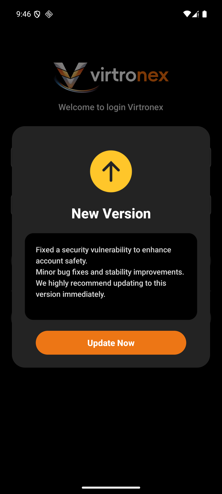
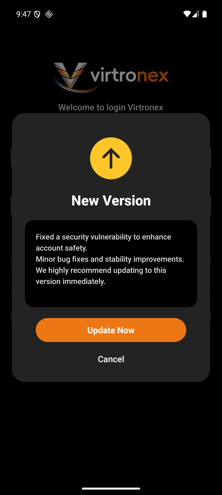

# 用户视角

Android `dev`，包 `com.vtron.pay`，渠道 virtronex、环境 tst。本机 `versionCode` 是 118，`versionName` 是 1.1.8。四端只跑这一端。H5、Web、iOS 不另开。

签名和公共头见 `19-OpenAPI会话`。

## 黑底 Virtronex logo

冷启动。系统启动主题的图标是纯色，接着约 2 秒是黑底居中的 Virtronex logo。

这一步不发请求。下一屏看本地有没有登录态。没登录进登录页，已登录进首页。这次没登录。

 

## 登录页上没有更新框

登录页和首页创建时发出。启动 logo 那一屏不发。

`POST /api/v1/app/version`。body 只有 `type`，值是 `android`。不传 `version_code`。

平时登录页上没有更新框，登录可以继续点。客户端拿响应里的 `versionCode` 和本机 118 比。不大于 118，框不出现。请求没有响应时，更新框同样不出现，登录可以继续点。这一屏没有文案。

 

## “New Version”，没有 Cancel

返回的 `versionCode` 高于本机 118 时，框盖在登录页上。

标题 “New Version”。没有 Cancel。底下的登录点不到。启动 logo 已经结束。

“New Version” 和 “Update Now” 是客户端自己的句子。框里的正文是响应里的 `updateContent`。客户端拿响应里的 `updateType`。是 0 就没有 Cancel。

同一条 `POST /api/v1/app/version`。按钮 “Update Now” 这次没点。

 

## “New Version”，有 Cancel

有 Cancel。

“New Version”、“Update Now”、“Cancel” 是客户端自己的句子。正文仍是响应里的 `updateContent`。客户端拿响应里的 `updateType`。是 1 就有 Cancel。

同一天、同一个 `versionCode` 只提醒一次。框一出现客户端就记下，不必等点 Cancel。同一天要再弹出，得是另一个 `versionCode`。记下的不在服务端。

同一条 `POST /api/v1/app/version`。按钮 “Update Now” 这次没点。
