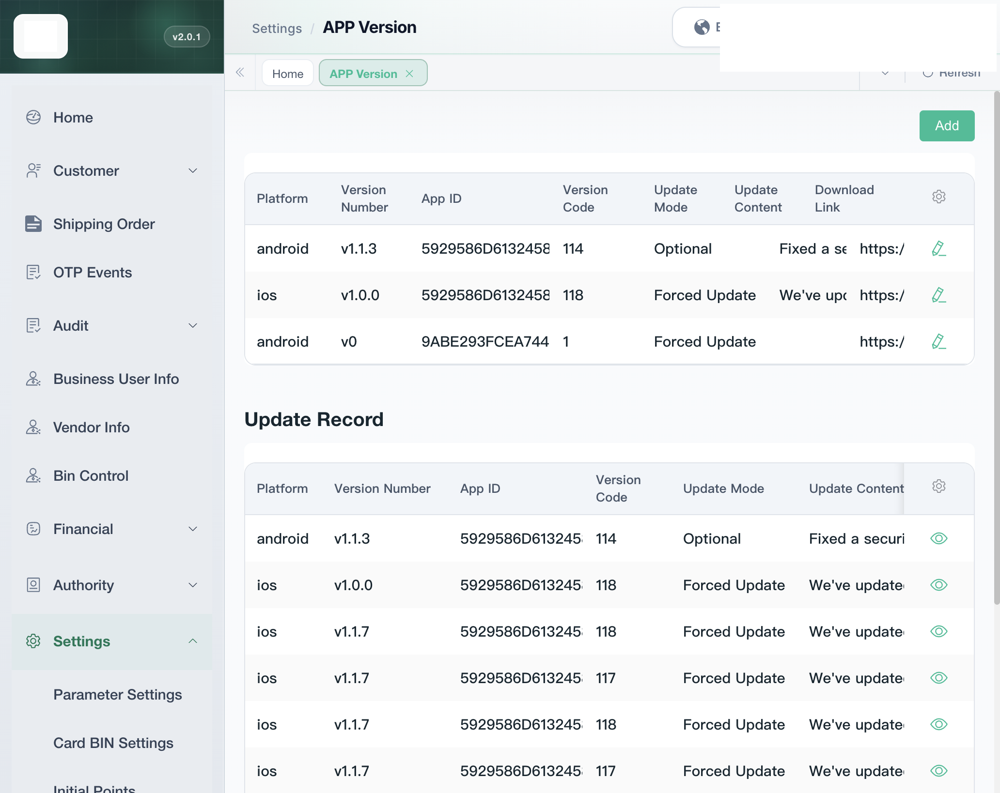
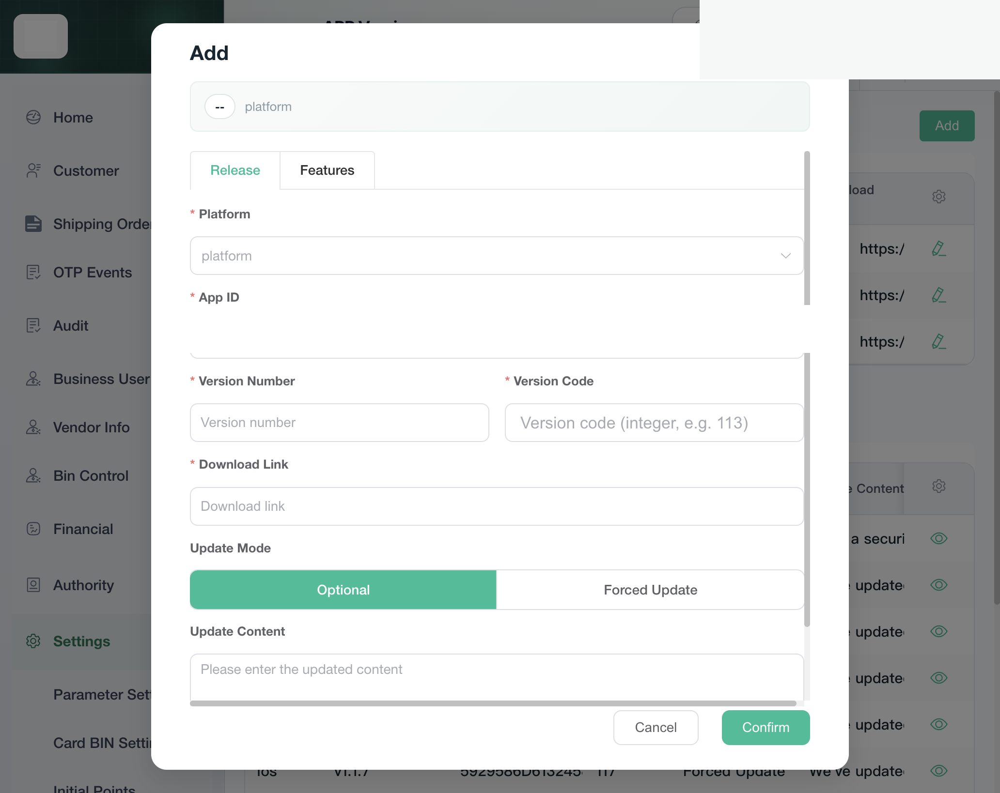
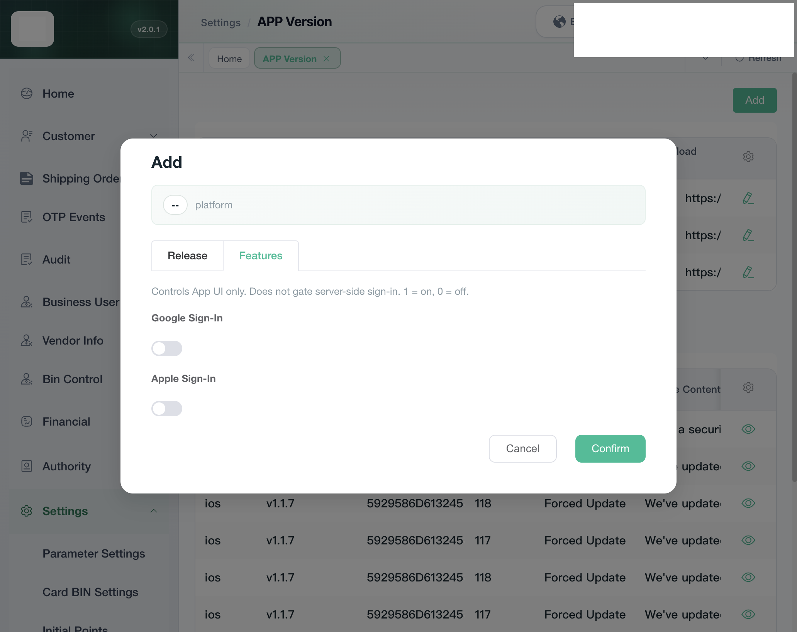

# 管理后台

测试环境新后台 `https://test-new-admin.vtron-card.com`。登录的是 Main Admin。菜单在 Settings → APP Version，地址 `/settings/appVersion`。参数设置、卡段设置见 `26-管理后台-系统`。

## 菜单「APP版本」列「更新方式」

标题 “APP Version”。当前表的列是 Platform、Version Number、App ID、Version Code、Update Mode、Update Content、Download Link。Update Mode 读 `update_type`：0 显示 Forced Update，其它显示 Optional。

当前三行：android `v1.1.3`，Version Code 114，Optional；ios `v1.0.0`，Version Code 118，Forced Update；另一条 android `v0`，Version Code 1，Forced Update。

`POST /settings/appVersion/current`。这一步不改字段。行上的铅笔打开编辑，见下一节。

下面是 Update Record。眼睛打开 “Version details”。更新方式只是一个标签，不能改。底下 `Close`、`Save`。`Save` 只改这一行的 Google Sign-In、Apple Sign-In。没有点 `Save`。

`POST /settings/appVersion/page`。

## “Add” 再插一行

按钮 “Add”。弹窗标题也是 “Add”，页签 Release。Platform 必填，选 `android` 或 `ios`。App ID 必填，默认选中平台那条。Version Number、Version Code、Download Link 必填。Update Mode 默认 Optional，另一项 Forced Update。Update Content 可空。`Cancel`、`Confirm`。没有点 `Confirm`。

已有行的铅笔打开同一个框，标题 “Edit”。平台和 App ID 不能改。`Confirm` 仍是再插一行，不改旧行。没有点 `Confirm`。

提交 `POST /settings/appVersion/add`。走接口，不是直接改库。

C 端不是马上盖框。下一次登录页或首页创建时会再问。返回的版本不高于本机 118 时，选了 Forced Update 也不弹出。

## Google、Apple 展示开关

同一个框的 Features 页。说明是 “Controls App UI only. Does not gate server-side sign-in. 1 = on, 0 = off.” 两个开关 Google Sign-In、Apple Sign-In，默认关。

更新记录的详情里也可以改这两个开关，`Save` 走 `POST /settings/appVersion/updateSignIn`。不改更新方式。C 端登录不读这个开关。见 `04-第三方登录`。没有点 `Save`。
