# 用户视角

跑的是 Android `dev`，包 `com.vtron.pay`，渠道 virtronex、环境 tst、debug。模拟器 `virtronex_api36`（Pixel 7，API 36）。2026-09-22。界面以这一端为准。H5、iOS 不跑。

Web 打开的是已部署的 `https://testbu3-web.vtron-card.com/auth`（2026-09-23）。本机 Web `newtest` 没有 `node_modules`，不是本地起的。和 Android 的差别在第 19 步。

Figma 桌面文件 Virtronex-APP，页 `0:1`「1. ✅❓❓ Login」。和 Android 对过的画面写在第 18 步。

第一包构建时没有 `openapi/virtronex.properties`，打进去的 app id 是空的。`OpenApiInterceptor` 发现密钥为空，请求不签名、不加密，原样发出。服务端回的文案是 “Application credentials are missing. Please try again later.” 第 1 到第 8 步是这一包。凡是要打到接口的步骤，都停在这一句，没有留下验证码页。

后来在本机补了这份文件（仓库忽略，不进 git），重新打了 virtronex tst debug 再装上。第 9 步起是这一包。发码、注册、登录都走通了。

账号查过 DBX 连接 `test`，库 `virtronex_business`。`merchant_login_log` 在 2026-09-22 18:38:33 有一条 Android 密码登录成功：设备 Google Pixel 7 Pro，商户 `100935`，`reseller_id` 88，`second_factor` 为 `email_otp`。`merchant` 这一行 `status = 1`、`register_via = email`，`google_verify.google_status = 1`。`password` 是 bcrypt，库里没有明文。本机 git 邮箱在 `merchant` 和后台库 `virtronex_business_admin_protal.admin_user` 里都没有对应行。没有用这条记录去试密码。第二包注册出来的是另一行：商户 `100985`，`reseller_id` 60，`status = 1`，`register_via = email`。公司码当时空着。第二包用的是平台凭证，空码只走 Nacos 默认邀请码 `cccccc`（`agent_invite_code.id` 84，挂在 reseller 60），所以不是密钥最初那个 BU。判定见 `BU对照.md`。

签名和公共头见 `19-OpenAPI会话`。发码见 `03-验证码与登录加固`。

## 1. 登录页

启动页是黑底 virtronex 标志，大约 2 秒后进入登录。这次没有版本更新弹窗。版本检查归 `01-启动与版本`。

标题 “Welcome to login Virtronex”。邮箱、密码、`No Account? Register`、`Forgot Password`、`Submit`。未填满时 `Submit` 是灰的。邮箱至少 3 个字符、密码至少 8 个字符后，按钮变橙。中间一条 `OR`，下面是 `Continue with Google`。屏幕上看不到语言切换。布局里 `slLanguage` 是 `invisible`。

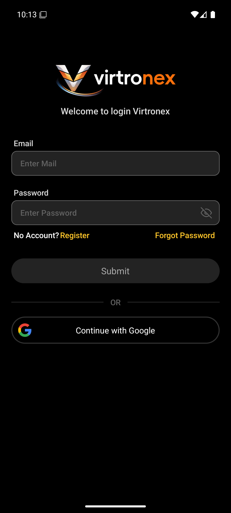

这一步不调接口。

按返回会离开应用，回到系统桌面。

Google 按钮属于 `04-第三方登录`。误触过一次，停在系统加载圈，返回后到了桌面，没有走完。

## 2. 登录邮箱格式不对

邮箱填了 `abc`，密码已满 8 位，点 `Submit`。

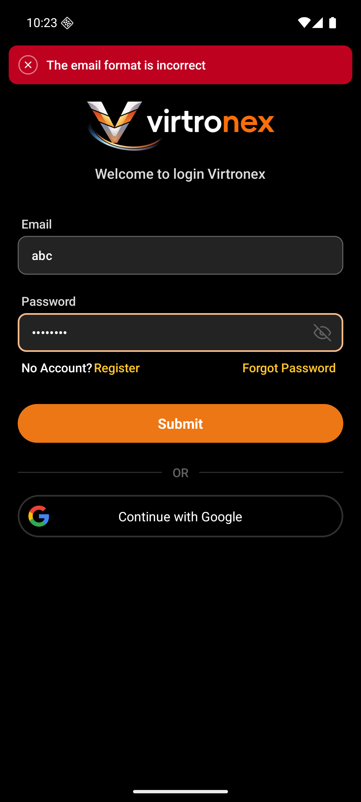

顶部红条 “The email format is incorrect”。停在登录页。这一步在客户端拦住，没有发请求。

## 3. 登录提交

邮箱格式通过、密码已填，点 `Submit`。

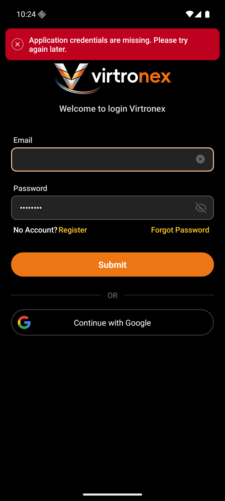

顶部红条 “Application credentials are missing. Please try again later.” 停在登录页，没有进入验证码页。

客户端这时要调 `POST /api/v1/auth/check/password`，参数 `username`、`password`。这个包没有带上 `X-App-Id`。密码错误、账号停用、锁定都还没走到。

校验通过后，源码会打开邮箱验证码页，再 `POST /api/v1/auth/login`（`authType = password`，带邮箱验证码）。验证码页这次没有留下来。

## 4. 注册页

登录页点 `Register`。

标题 `Register`，副标题 “Welcome to join Virtronex”。邮箱、`Company Code`（右侧扫码图标）、`Have Account? Login`、`Continue`。底部未勾选 “I've read & agree to User Agreement & Privacy Policy”。邮箱还不是合法格式时 `Continue` 是灰的。公司码可以空着。

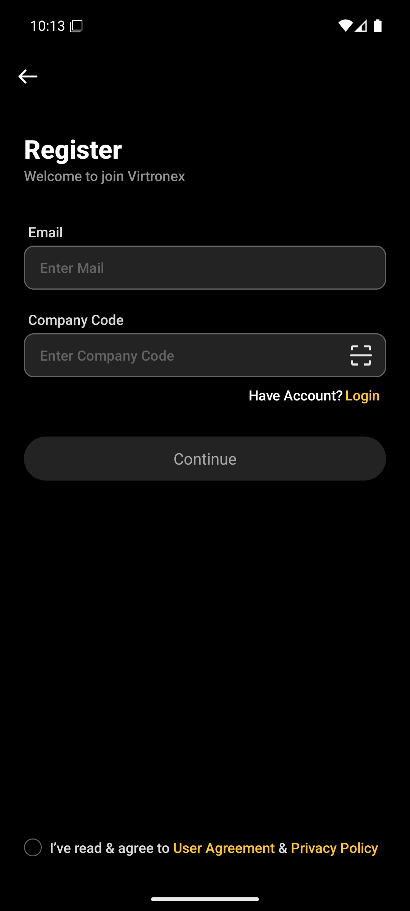

扫码图标没有点。见 `34-扫码邀请码`。

## 5. 注册邮箱格式不对

邮箱里只有一个字符。

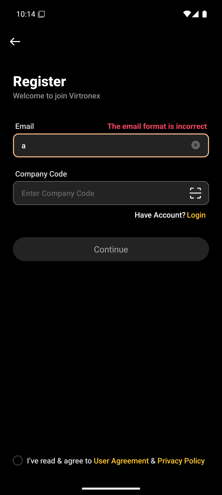

框上方红字 “The email format is incorrect”。`Continue` 仍是灰的。不发请求。

## 6. 注册已填邮箱，还没同意协议

邮箱格式通过后 `Continue` 变橙。公司码仍空着。

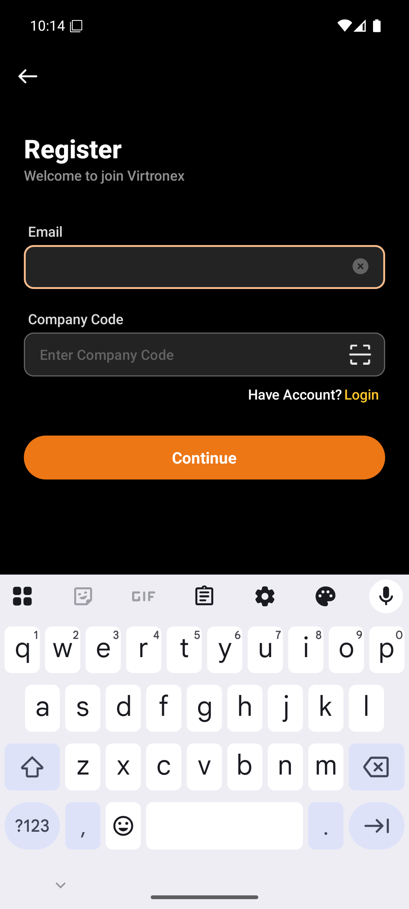

未勾选协议时点 `Continue`，底部弹出 “Agree to Terms”。正文 “By clicking agree and continue, you accept the User Agreement & Privacy Policy”。按钮 `Agree and Continue`、`Cancel`。

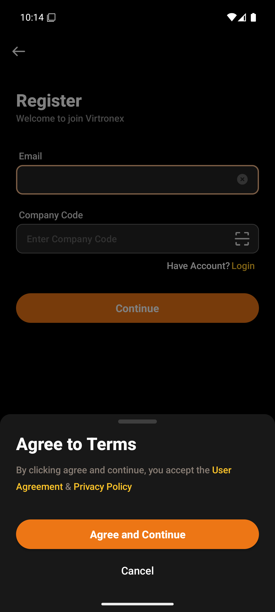

`Cancel` 这次没单独点。点 `Agree and Continue` 会勾上协议并进入下一步。

启动和登录页没有协议。点注册页底部的 User Agreement。

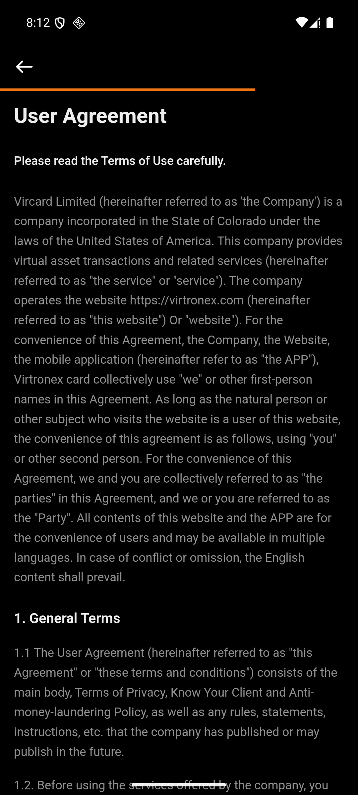

WebView 打开 `https://terms.virtronex.com/user-agreement`。页顶只有返回。标题 “User Agreement”，开头是 Vircard Limited 的 Terms of Use。这一步不调 `virtronex-api`。Privacy Policy 没点。地址是同一站点的 `/privacy-policy`。

## 7. 同意之后发码失败

勾上协议后，马上回到注册页，顶部红条 “Application credentials are missing. Please try again later.” 协议保持勾选。

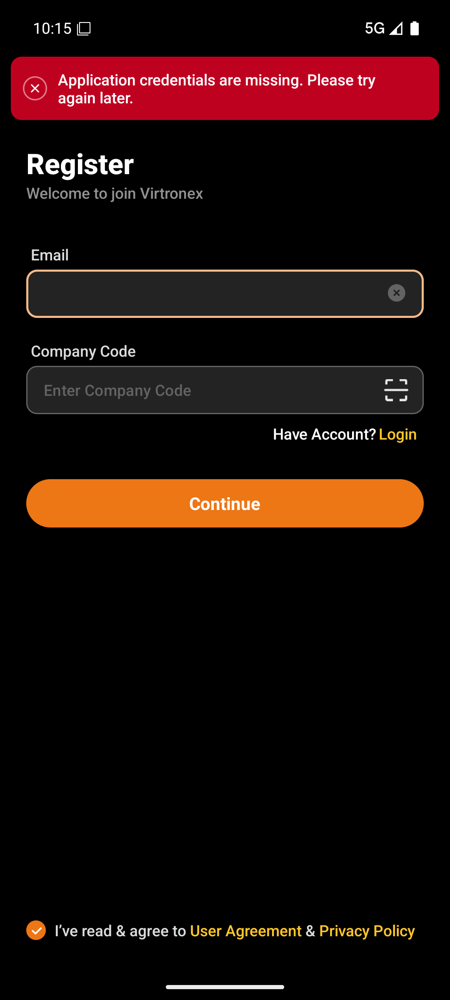

客户端这时打开验证码页，一进来就 `POST /api/v1/email/send`，参数 `email`、`type`（注册）、可选 `agentInviteCode`。发码失败时，注册和重置大约 800 毫秒后关掉验证码页。这一包没有截到验证码页，也没有设密页、注册成功页。`POST /api/v1/customer/register` 没发出。第二包装上凭证之后，同一条路走通了，见第 9 步。

## 8. 重置密码

登录页点 `Forgot Password`。

标题 “Reset password”。邮箱、`Recovered? Login`、`Submit`。邮箱不合法时 `Submit` 是灰的。

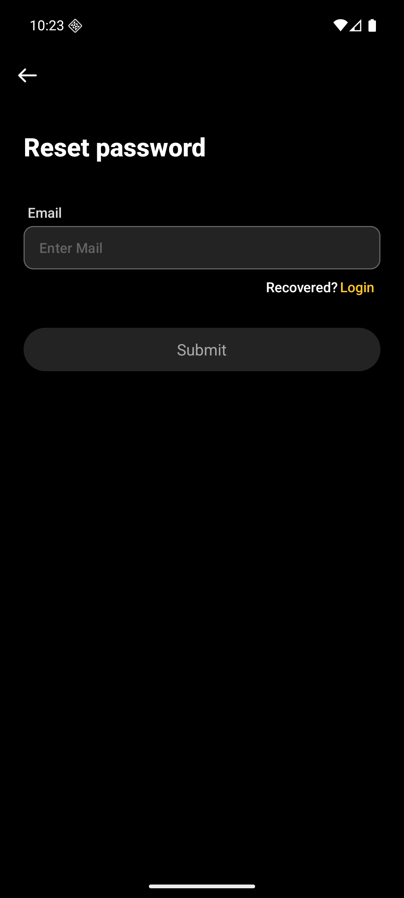

邮箱里只有一个字符时，框上红字 “The email format is incorrect”，`Submit` 仍不可点。不发请求。

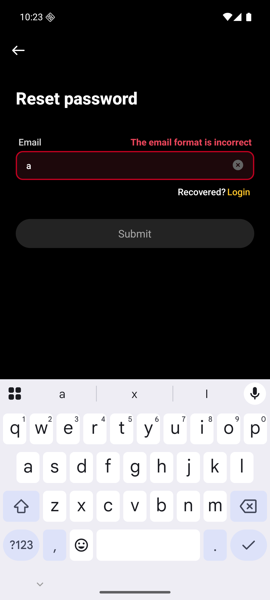

合法邮箱的提交在第一包没有点。第二包补上凭证之后走完了，见第 13 步。

## 9. 带凭证的注册

第二包。登录页点 `Register`，邮箱格式通过，公司码空着。未勾选协议时点 `Continue`，仍弹出 “Agree to Terms”。点 `Agree and Continue` 进入 `Email Verify`，不再被缺凭证打回。

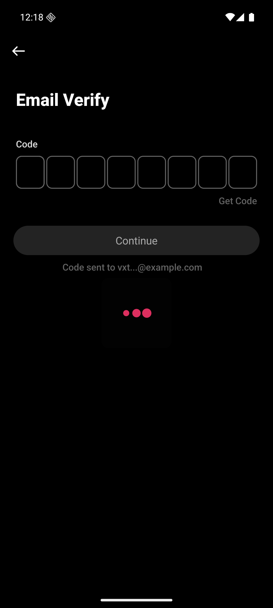

这张是发码请求还在转的时候。转完之后页面留着：8 格验证码、右侧倒计时、`Didn't receive the email?`、`Check spam folder`，邮箱显示成打码后的 `vxt...@example.com`。码没填满时 `Continue` 是灰的。填满 8 位后变橙。

点 `Continue` 进入设密。四条规则都变绿之后 `Continue` 可点。两次密码不一致时源码会吐司拦住，这次两次相同，没有看到那句。

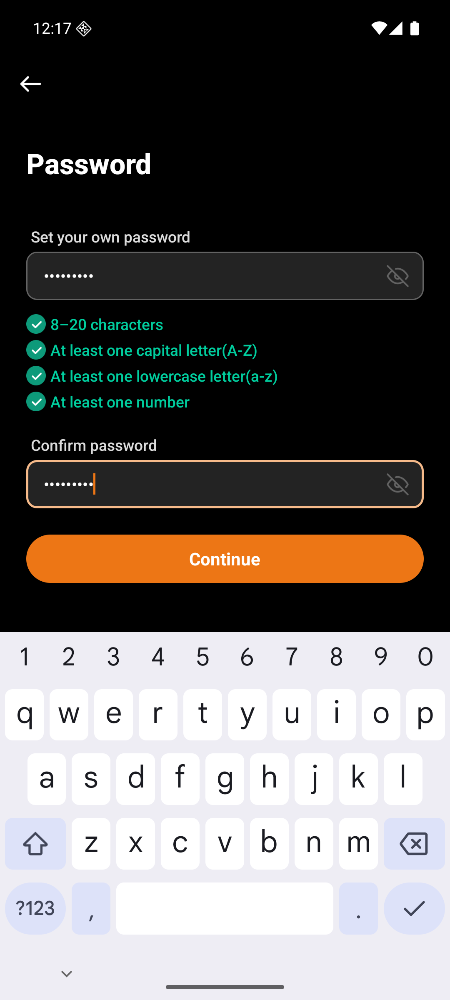

点 `Continue` 后出现 “Account Registered”，文案 “Page will redirect in 0 second”。

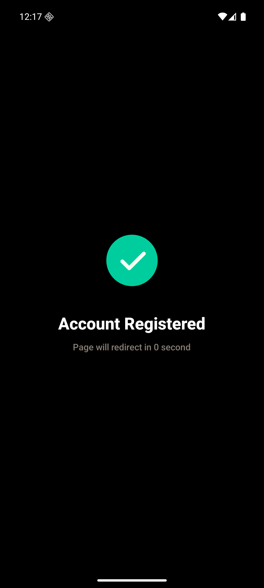

接着是 “Enable Instant Notifications”。点 `Skip` 回到登录页，邮箱被带了回来，密码框是圆点，`Submit` 已是橙色。这一步没有进首页。库里新商户是 `100985`，`reseller_id` 60。`POST /api/v1/customer/register` 这次发出去了。

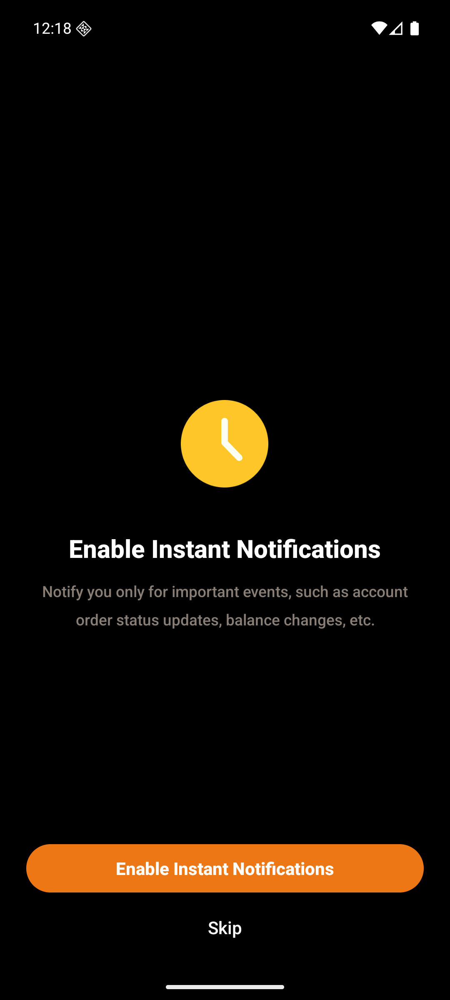

## 10. 带凭证的登录

还在登录页，邮箱和密码已经填着，点 `Submit`。没有再出现缺凭证。进入同一张 `Email Verify`，文案仍是 “Code sent to vxt...@example.com”。填满验证码点 `Continue`，先到通知页。再点 `Skip` 进入首页 `MainActivity`。

首页能看到 Total / Avai. / Freeze Balance，都是 `0.00`，以及 Topup、Withdraw。底部弹出 “Get Ready”，要做 KYC 才能开卡。按钮 `I'm Ready`、`Cancel`。KYC 本身见 `07-KYC与持卡人`，这次没有点进去。

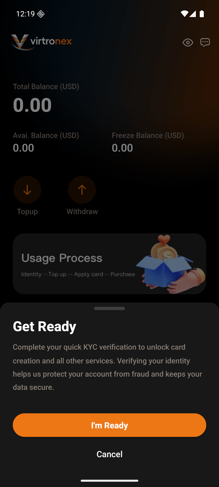

`Submit` 对应 `POST /api/v1/auth/check/password`。验证码之后才是 `POST /api/v1/auth/login`。

## 11. 密码错误

登录页邮箱已填，密码换成一个不对的，只点了一次 `Submit`。

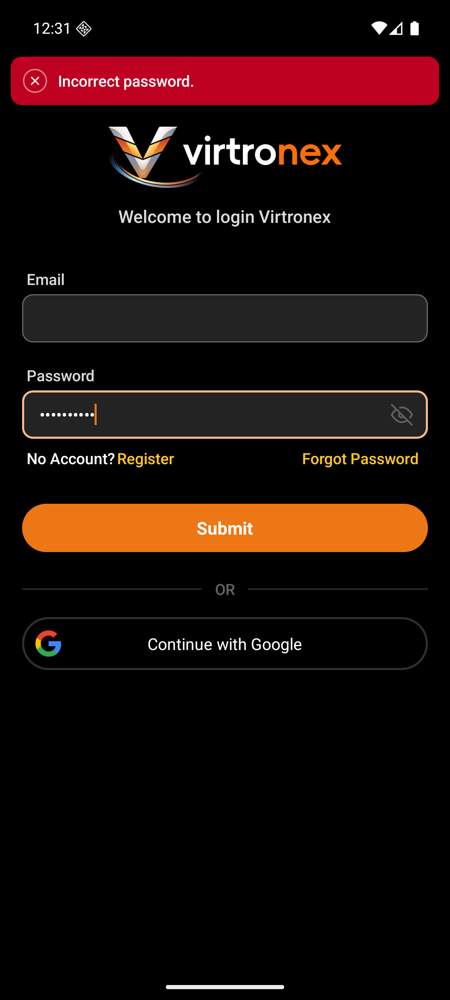

顶部红条 “Incorrect password.” 停在登录页，没有进验证码页。这一步是 `POST /api/v1/auth/check/password`。连续错到锁定见第 16 步，那次先撞上了频控。

## 12. 验证码错误

用正确密码再进登录验证码页，8 位填了一个不对的码，只点了一次 `Continue`。码被清空，停在这一页。`Code` 右侧红字 “2 attempts remaining”。邮箱仍是打码后的 `vxt...@example.com`。没有再错第二次，所以没看到锁 30 分钟那句。

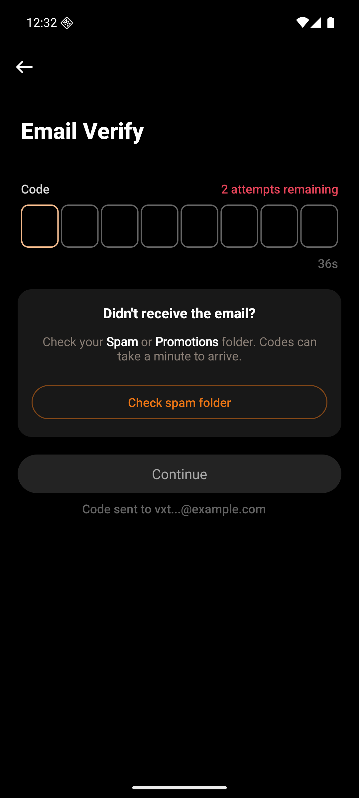

## 13. 重置密码走完

从登录页点 `Forgot Password`，填已注册邮箱，点 `Submit`。标题变成 “Reset password”，不是注册那张 “Email Verify”。倒计时、`Code sent to vxt...@example.com` 都在。这一页没有单独截稳。

验证码通过后是设密，标题仍是 “Reset password”。两次密码不一致时点 `Continue`，顶部红条 “The two passwords entered are different.” 停在设密页。

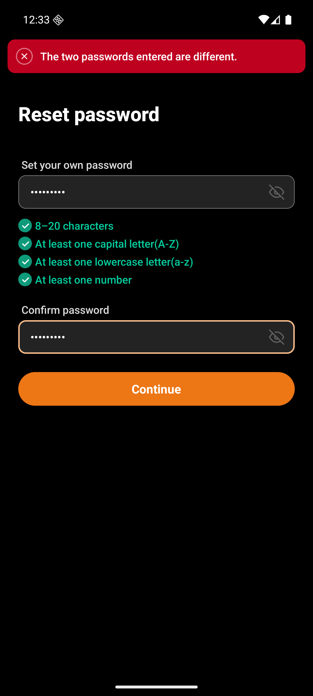

改成两次相同再点 `Continue`，回到登录页。顶部绿条 “Password reset, please use new password”。邮箱和密码被带回来，密码是圆点。`POST /api/v1/customer/forgetPassword` 这次发出去了。

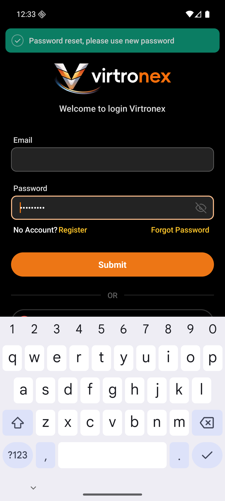

## 14. 退出登录

首页进 Account，滑到 `Sign Out`。底部弹出 “Sign Out”，正文 “You are about to log out of your current account. Do you want to continue?” 按钮 `Proceed to Sign Out`、`Cancel`。页上邮箱已经打成 `vxt****@example.com`，旁边是 `ID: 100985`。

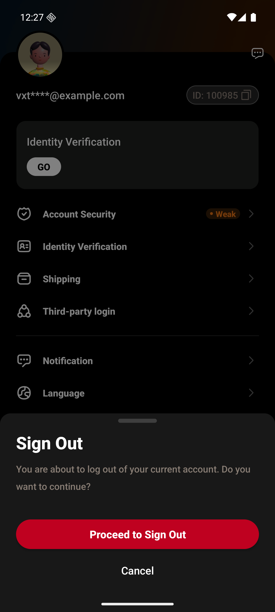

点 `Proceed to Sign Out` 回到登录页。对应 `POST /api/v1/auth/logout`。

## 15. 账号停用

商户 `100985` 的 `status` 为 0 时，用正确密码提交。`check/password` 仍通过，进了验证码页。填完验证码点 `Continue`，停在验证码页，顶部红条是文案键 `user.disabled`，没有换成一句英文。

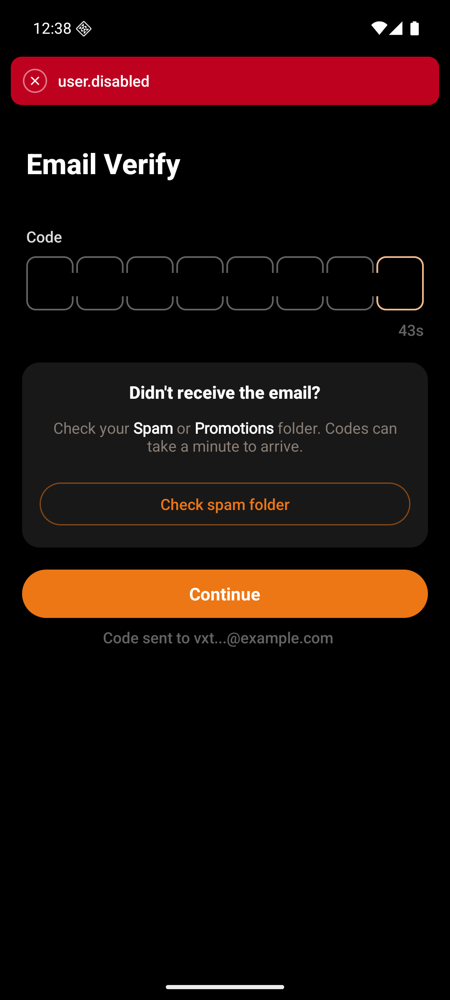

## 16. 连续提交被限流

还在商户 `100985` 上连续点错误密码，想看锁定。点得太密之后红条变成 “Too many requests. Please try again in 1 minute.” 停在登录页。这是 `check/password` 按 IP 和设备计数的频控，不是密码错误次数锁。没有在这个账号上继续等。

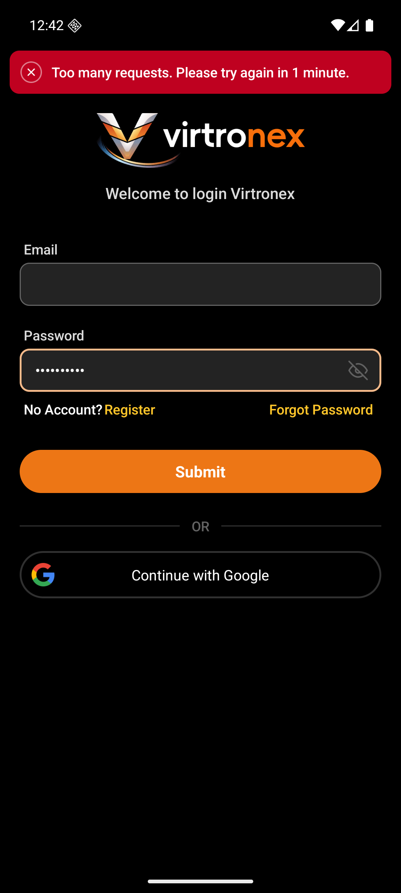

## 17. 登录锁定

换了一个新注册的商户 `100986`。错密码隔开再点，不再挤在同一次加载里。红条从 “Incorrect password.” 变成 “Account temporarily locked. Please try again in 15 minutes.” 停在登录页，没有进验证码页。

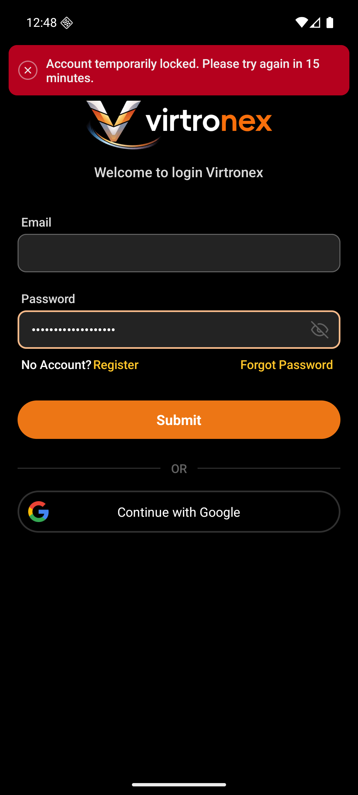

## 18. 和 Figma 对过的地方

页 `0:1`。邮箱登录、重置、注册三组都在。

对得上的：登录标题 “Welcome to login Virtronex”，邮箱、密码、`No Account? Register`、`Forgot Password`、`Submit`（`158:1281`，1-1-0）。密码错误红条 “Incorrect password”（`158:1683`，1-1-7）。验证码页标题 “Email Verify”，8 个格子，旁边有批注「验证码 4位数 改成 8位数」（`158:2098`，1-1-8；批注 `10753:10150`）。重置第一页标题 “Reset Password”（`160:2454`，1-2-1）。设密四条规则是 8–20 位、大写、小写、数字（`160:2673`，1-2-10），和注册密码正则一致。重置成功回到登录，绿条 “Password reset, please use new password”，邮箱已填上（`160:3128`，1-2-18）。注册成功 “Account Registered”，下一页 “Enable Instant Notifications” 和 `Skip`（`3:2758`，1-3-22；`3:2768`，1-3-23）。

对不上的，以 Android 这次走查和后端为准：

- 稿上未注册是 “Email not registered”（`158:1629`，1-1-6）。后端找不到用户和密码错误都是 `20007`，Android 上密码错误红条是 “Incorrect password.”。
- 稿上密码标签旁还有 “Incorrect”。Android 只有顶部红条。
- 稿上验证码错是 “There are still two chances left”（`158:2129`）。Android 是 “2 attempts remaining”，并且清空格子。
- 稿上重置成功后密码框仍是 “Enter Password”。Android 把新密码也带了回来。
- 稿上注册成功写 “Page will redirect in 3 second”。Android 是 “Page will redirect in 0 second”，然后进通知页，点 `Skip` 回登录，没有进首页。
- 稿上登录默认页有 “I have a card, I want Fiat account”，右上角 EN 看得到，这一帧没有 `Continue with Google`。Android 有 Google 按钮，看不到语言切换，没有 Fiat 这一行。Google 的画面在同一页更左边，标题是「未注册用户使用谷歌快捷登录」，归 `04-第三方登录`。
- 稿上注册页画了 “Digital card only” 和 “【Card with Fiat account】”（`162:3887`，1-3-1）。分析分支四端不调 `bankFunction`。
- 稿上 `158:1577`（1-1-5）盖了一层 “Pic图片验证”。Android `feature/user` 里没有 captcha，这次登录也没出现。
- 稿上重置邮箱不存在是 “Email does not exist”（`160:2511`，1-2-5）。后端是 `40092`，文案键 `password.reset.failed`，不返回账号不存在。Android 这次没点一个不存在的邮箱。
- 名叫「密码重复」的那一帧（`160:2896`，1-2-16）红条是 “New password cannot be the same as the old one”。Android 两次不一致时是 “The two passwords entered are different.”。稿上没有这句。
- 停用、登录锁定、“Too many requests” 在这一页没有对应画面。

## 19. Web 测试站

`https://test-m.vtron-card.com/` 返回 302，落到 `https://testbu3-web.vtron-card.com/`。登录、注册、重置都在 `/auth` 同一张卡片里切换，没有 Android 那种分开的验证码页和设密页。没点提交，所以没看到错误红条、停用、锁定。

登录标题 “Login to your account”。邮箱、密码、协议勾选、`Continue`、`Continue with Google`、`Forgot password?`。Android 登录页没有协议勾选，标题是 “Welcome to login Virtronex”，按钮是 `Submit`。

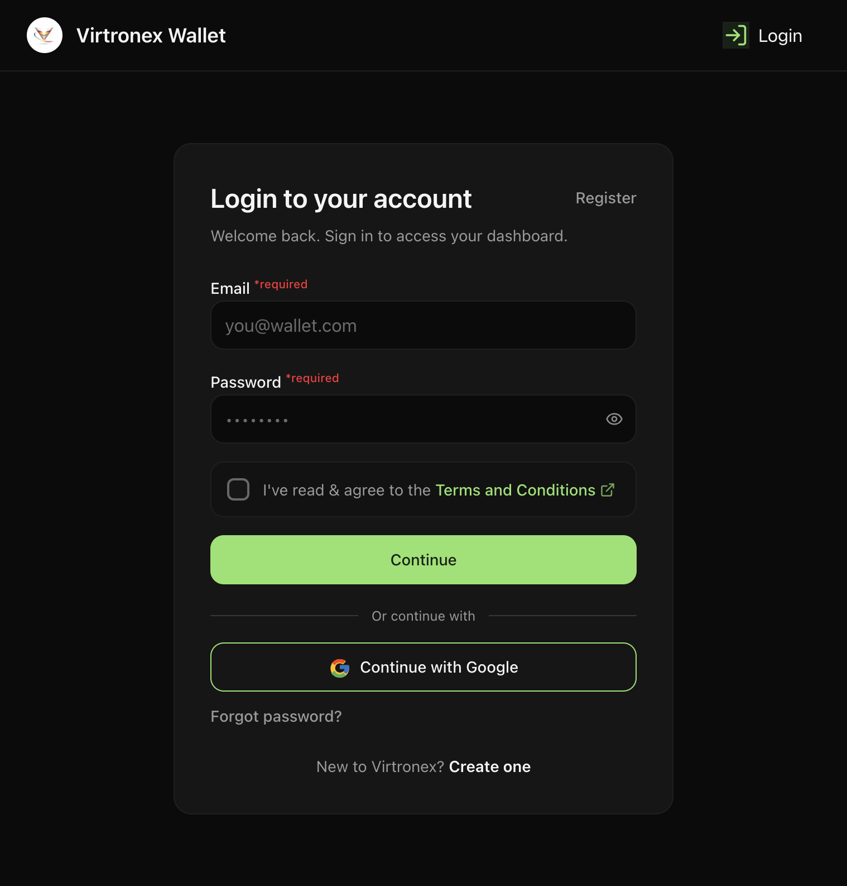

注册标题 “Create your account”。同一页有邮箱、密码、公司码、8 位邮箱码和 `Send code`。公司码标了 *required，旁边是上传邀请码图。Android 公司码可以空着，验证码和设密是后面两页。这里没有第二次确认密码，也没有 Fiat / Digital。

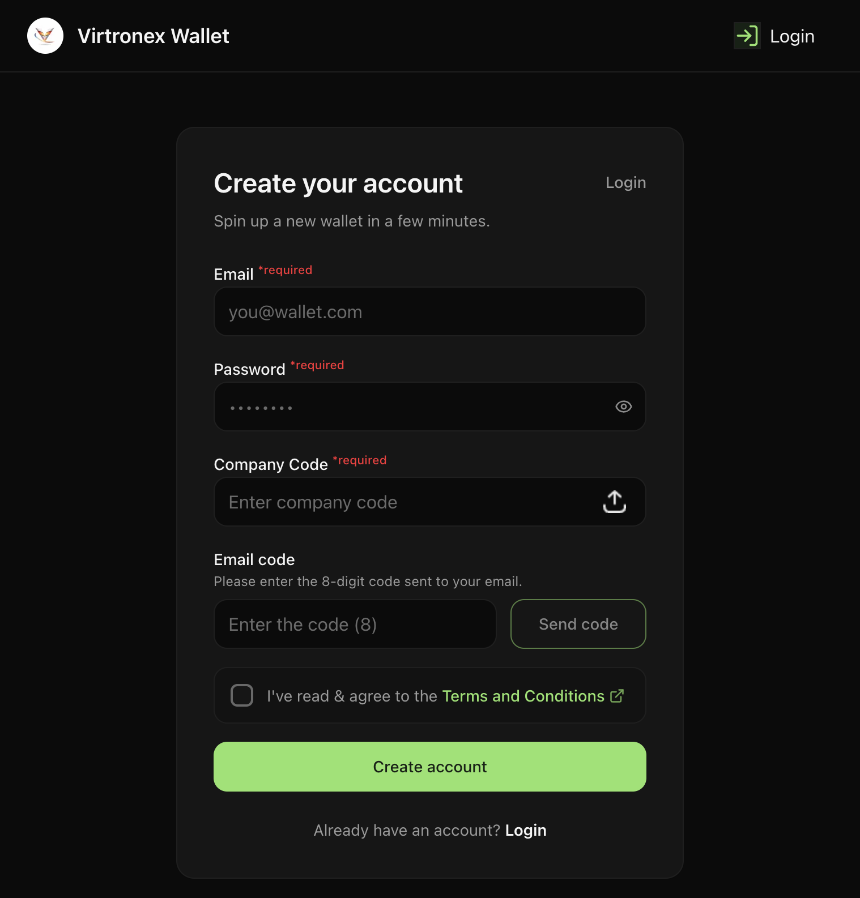

重置标题 “Reset password”。同一页有邮箱、新密码、8 位邮箱码。没有确认密码框。Android 是先邮箱、再验证码、再两遍设密。

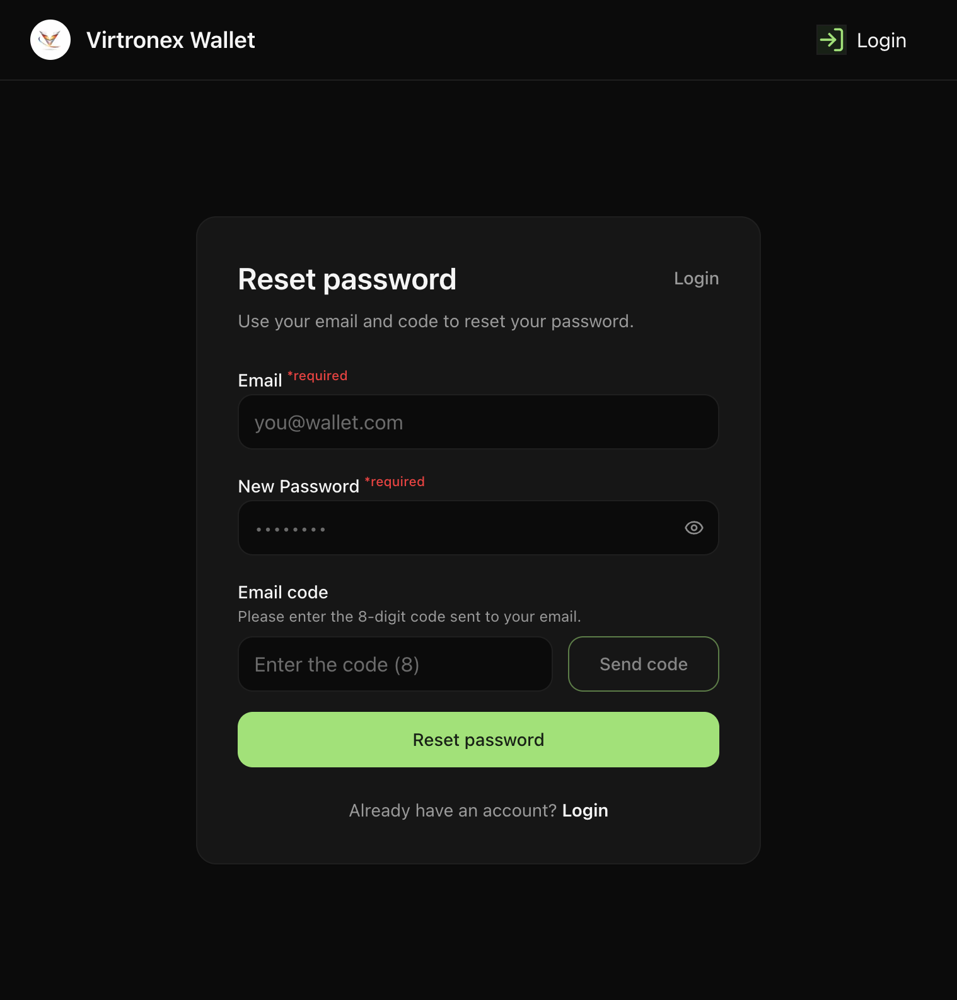

## 本步没有

- `POST /api/v1/auth/check/emailExists`：这个登录按钮走的是 `check/password`
- `POST /api/v1/customer/bankFunction`：H5 `test`、WebApp `newtest`、Android `dev`、iOS `release` 都搜过，没有这个调用
- H5、iOS 的界面。这一篇只跑 Android
