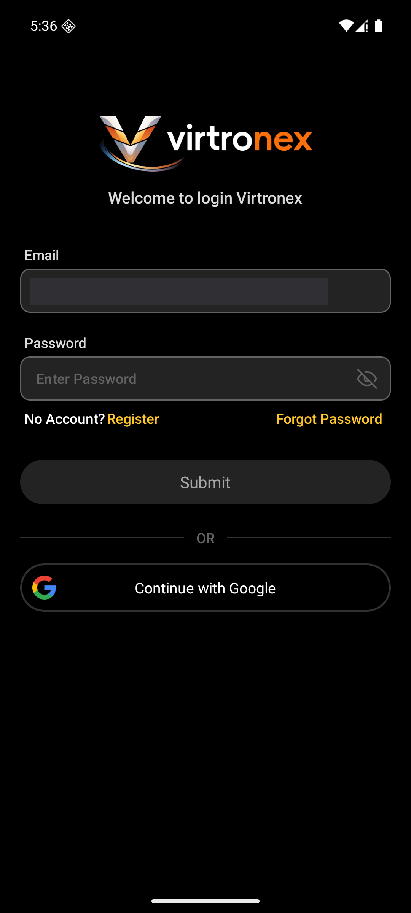
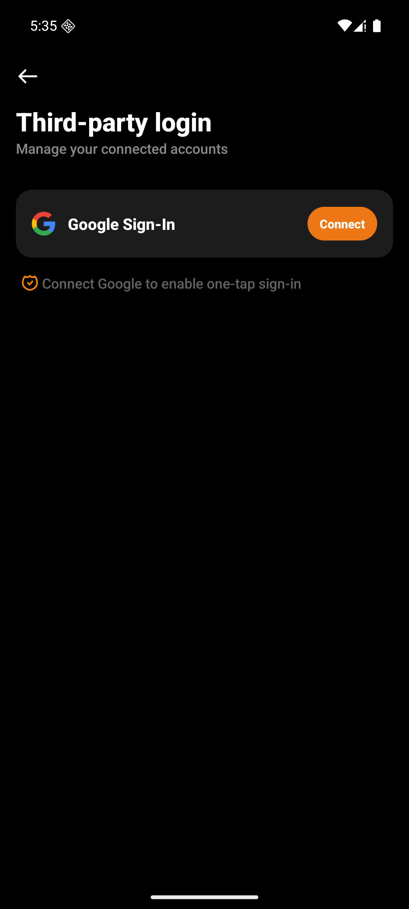

# 用户视角

Android `dev`，包 `com.vtron.pay`，模拟器 `emulator-5554`。H5、Web、iOS 这次没打开。

测试商户 `100985`。进来时已经登录，Google Sign-In 还没连上。看完未连接那一页之后，从 Account 点了 `Sign Out`，回到登录页。确认那一层这次没截下来。

## 1. 登录页

标题 “Welcome to login Virtronex”。邮箱框里还留着上次的地址，已打码。密码框是 “Enter Password”。下面 `Submit`，一条 “OR”，再下面 “Continue with Google”。这一行能看见，说明这个包的 `enableGoogleLogin` 是开的。

点 “Continue with Google” 之后离开本应用，进了系统的 Google 账号页。先是 “Checking info…”，随后 “Sign in - Google Accounts”，“Sign in with ease”，按钮是 `SKIP` 和 `NEXT`。没有在本应用里拿到身份，所以连密码的 “Welcome Back” 和设密注册都没出现。按返回离开，没有添加 Google 账号，也没有发出 `auth/google/login`。

## 2. 已登录：还没连接

Account 列表里有 “Third-party login”。这一行和登录页那颗按钮是同一个开关，没开时列表里不会有。

进去标题 “Third-party login”，说明 “Manage your connected accounts”。一行 “Google Sign-In”，右侧橙色 `Connect`。下面 “Connect Google to enable one-tap sign-in”。没有 `Connected`，也没有 `Disconnect`。

没有点 `Connect`。点下去会先走和上面一样的 Google 账号页。这个商户的验证器已经开着，身份拿回来之后下一页才是动态码，不是邮箱码。这次没走到。

## 3. 这次没走

- `40104` 之后的 “Welcome Back” 和连密码
- `40106` 之后的设密注册
- 已连接时的 `Connected`、`Disconnect`，以及 “Disconnect Google Account”
- 动态码页 `GoogleSignInVerifyActivity`，和没开验证器时的邮箱验证码页
- “Unable to Sign in”（这个 Google 已经绑在别的账号上）
- 连接成功、断开成功的提示
- H5、Web、iOS
- 目录里的稿是父项 `0:1` Login 的第三方入口。这次没有对上单独一帧
