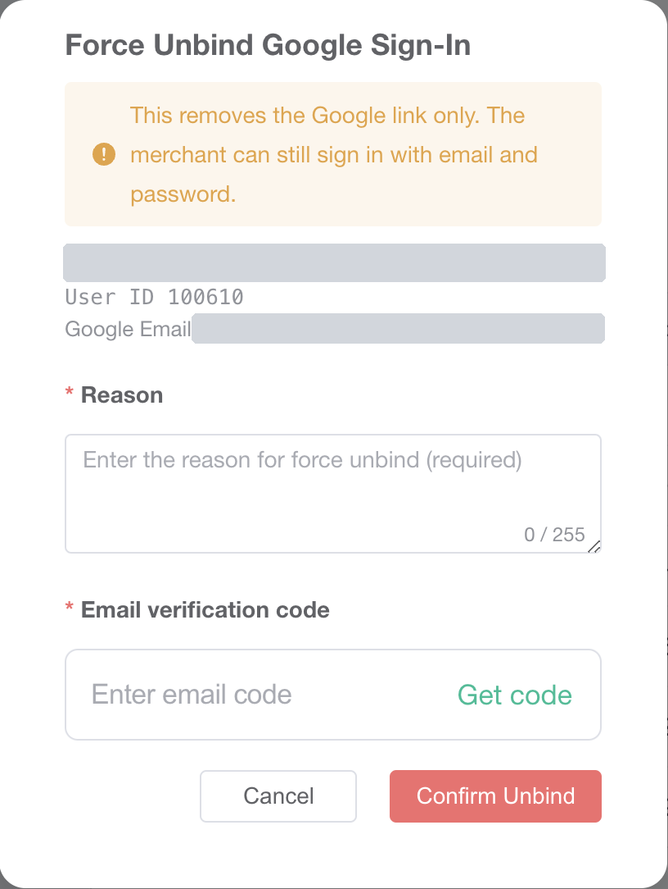

# 管理后台

C 端自己连接、断开在 `02-用户视角`。运营这边是另一条：把已经连上的 Google 账号从商户上摘掉。商户仍可用邮箱和密码登录。这不是账户安全里的动态码，也不是右上角员工自己的 Google Authenticator。

测试环境新后台 `https://test-new-admin.vtron-card.com`。登录的是 Main Admin（`sys_role.role_key = main`）。菜单在 Authority → Google Bindings，地址 `/system/googleBinding`。银行后台这次没打开。

## 1. 列表

筛选项是 Platform email、Google email、Bind status（Bound / Unbound）、Bound from、Bound to，旁边 Search。列是 User ID、Email、Google Sub、Google Email、Status、Bound At、Last Google Login。未绑定的商户也在这张表里。刚进页面时一共 927 行，第一页是较新的未绑定账号。

商户 `100985` 在第一页，Status 是 Unbound。Google Sub 是 `-`，Google Email、Bound At、Last Google Login 是 `--`。库里 `merchant_google_bind` 没有这一行。这一行的操作只有 `View`，没有 `Force Unbind`。

Bind status 选 Bound 之后一共 6 行，每一行操作都有 `View` 和 `Force Unbind`。

列表权限是 `bu:googleBinding:list` 或 `main:googleBinding:list`。查看是 `bu:googleBinding:query` 或 `main:googleBinding:query`。强制解绑是 `bu:googleBinding:forceUnbind` 或 `main:googleBinding:forceUnbind`。没有对应权限时，行上不拼那一项。这次没有换一个没有该权限的账号再看。

新菜单表 `virtronex_business_admin_protal.admin_menu` 里没有这条。旧表 `virtronex_main.sys_menu` 有 `2761`，菜单名「Google绑定管理」，`parent_id = 1`，`path = googleBinding`，组件 `security/googleBinding/index`，权限 `bu:googleBinding:list`，`visible = 0`、`status = 0`（这套表里是显示且启用）。`2762` 是查询，`2763` 是强制解绑。角色菜单包含 `2761` 的有 Main Admin、Business User、Agent门户。这次只登录了 Main Admin。界面英文是 “Google Bindings”。

Customer → Basic Info 行里的 Reset GoogleAuthenticator 归 `06-谷歌验证器`。这次没从那一页进。

## 2. 未绑定的详情

`100985` 点 `View`，标题 “Google Binding Detail”。User ID `100985`，Registration Method 是 Email，Account Status 是 Normal，Status 是 Unbound。User 一栏有邮箱和 Created At `2026-09-23 00:17:39`，邮箱已打码。Google Binding 一栏是 “Not connected to Google Sign-In.”。Binding History 表头是 Time、Event、Operator、Detail，内容 No Data。底下只有 `Close`，没有强制解绑。接口是 `POST /security/googleBinding/detail` 和 `POST /security/googleBinding/logPage`。

## 3. 强制解绑弹窗

在 Bound 的一行（User ID `100610`）点 `Force Unbind`。标题 “Force Unbind Google Sign-In”。警告是 “This removes the Google link only. The merchant can still sign in with email and password.” 下面是平台邮箱、User ID、Google Email，邮箱已打码。Reason 必填，占位 “Enter the reason for force unbind (required)”，计数 `0 / 255`。Email verification code，旁边 `Get code`。`Cancel`、`Confirm Unbind`。这次这个员工没有谷歌码那一格。源码里员工已经绑了验证器，才会多出谷歌码。

没有点 `Get code`，也没有点 `Confirm Unbind`，点了 `Cancel`。弹窗关掉之后这一行仍是 Bound。库里 `merchant_id = 100610` 的 `status` 仍是 `1`，`deleted` 仍是 `0`。成功提示 “Google Sign-In unbound” 这次没出现。

`Get code` 走的是员工自己的邮箱，类型 `platformForceUnbindMerchantGoogle`，接口 `POST /email/sendCheckEmailWithoutEmail`，不是商户邮箱。确认走 `POST /security/googleBinding/forceUnbind`。

## 4. 提交时代码会做什么

这次没有提交。`MerchantGoogleBindingServiceImpl.forceUnbind` 先看商户、验证码、原因是否都有，原因去空格后仍为空或长于上限，都是 `merchantGoogleForceUnbind.param.required`，英文 “Required parameters are missing.”。商户不在当前数据范围里是 `record.notFound`。没有仍生效的绑定，或解绑时刚好被别人先解掉，都是 `google.not.bound`，英文 “No Google account link was found.”，不再写一条日志。

核对操作者验证码之后，`softUnbindByMerchantId` 把这一行改成 `status = 0`、`deleted = id`，显示名和头像清空。`google_sub`、`google_email` 留在行上，查询只看 `deleted = 0`。然后往 `merchant_google_bind_log` 插一行，`event_type = unbind`，`operator_type = admin`，带原因、操作者、IP。控制器注释写明这一步不踢商户在线会话。这次没有提交，所以没有在已登录的客户端上再看。
