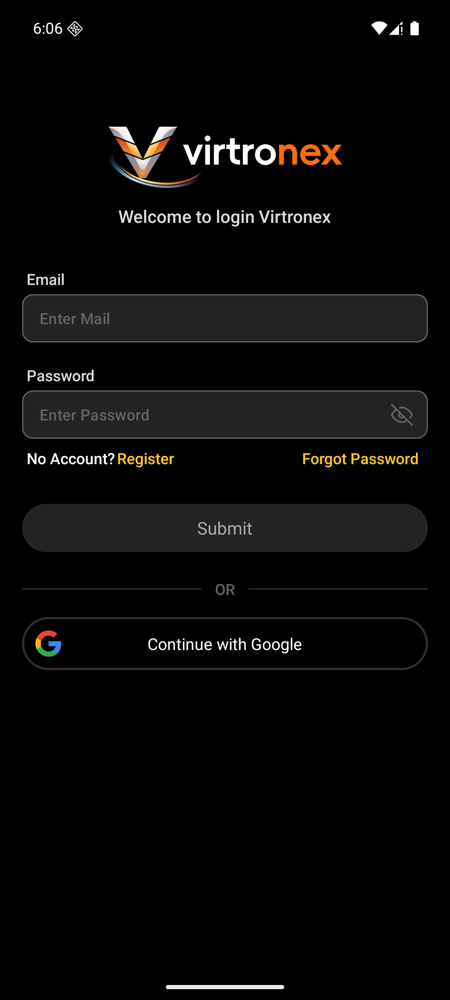
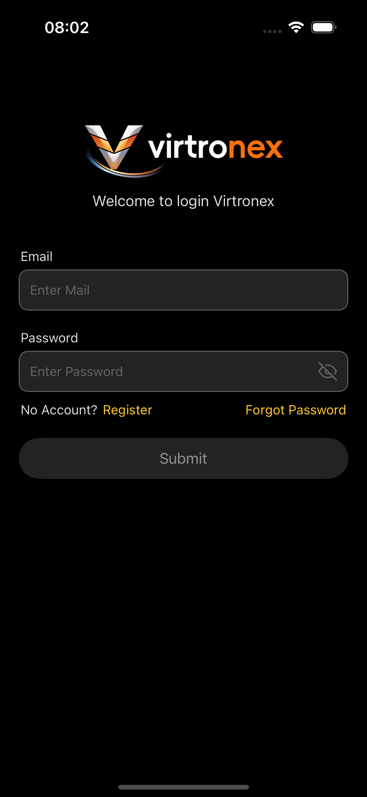
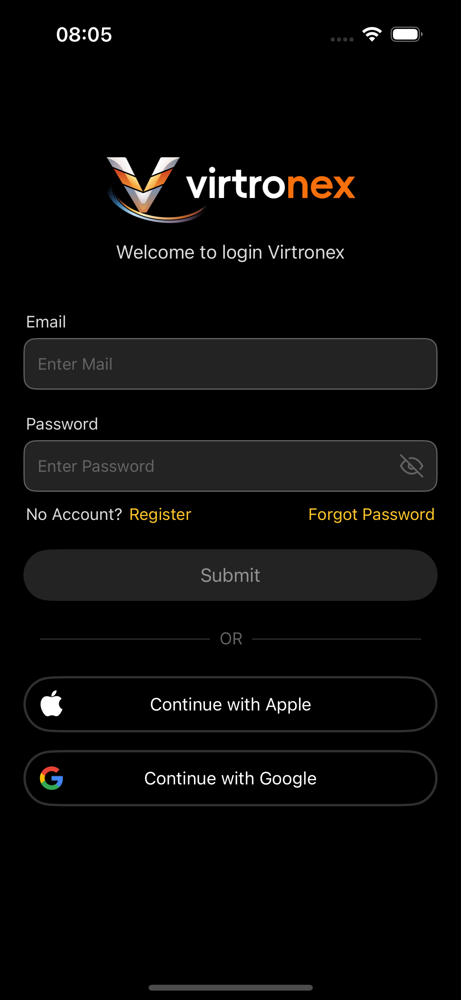
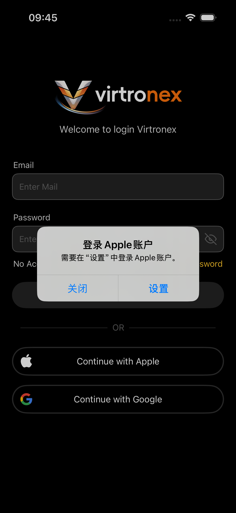
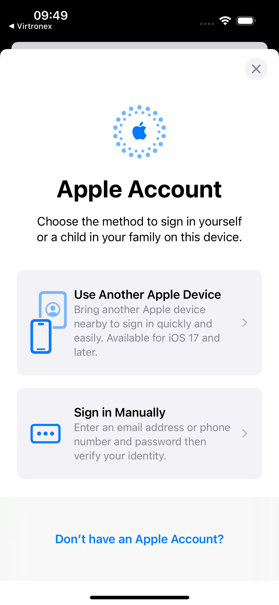
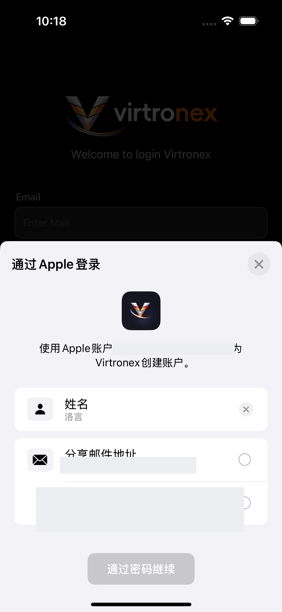
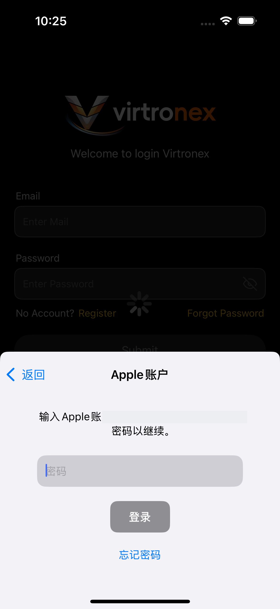
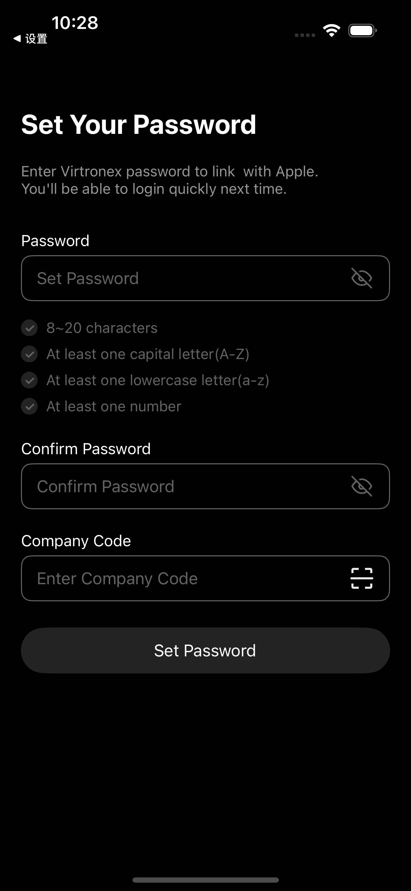

# 用户视角

Android `dev`，包 `com.vtron.pay`，模拟器 `emulator-5554`。iOS `release`，包 `newcardvtrpn.app`，模拟器 iPhone 16（iOS 18.6）。2026-09-23 `git pull` 两边都已是最新。两端都停在登录页，没有登录账号。H5、Web 这次没打开。

## 1. Android 登录页

标题 “Welcome to login Virtronex”。邮箱框是占位 “Enter Mail”，密码框是 “Enter Password”。下面 `Submit`，一条 “OR”，再下面只有 “Continue with Google”。没有 “Continue with Apple”。

布局 `activity_login.xml` 里第三方按钮只有 `llGoogleLogin`。字符串里没有 Apple 登录文案。搜过 `Sign in with Apple`、`appleSignIn`、`auth/apple`、`enableAppleLogin`、`Continue with Apple`，命中的是卡面上的 Apple Pay 图标，以及冻结说明里的 Apple Pay，不是登录。

没有点 “Continue with Google”。

## 2. 已登录页这次没进

Account 里的 “Third-party login” 要先登录。这次没登。布局 `activity_third_party_login.xml` 只有一行 “Google Sign-In”，说明是 “Connect Google to enable one-tap sign-in”。没有 Apple 那一行。`ThirdPartyLoginActivity` 的注释也只写绑定和解绑 Google。

## 3. 其他端

H5 `test`、WebApp `newtest` 2026-09-23 `git pull` 已是最新。搜 `auth/apple`、`appleSignIn`、`Continue with Apple`、`bindApple`：H5 登录页和 `pages/account/thirdPartyLogin` 只有 Google。Web 登录页文案是 “Continue with Google”，`ThirdPartyLoginCard` 也只接 Google。两端都没有 Apple 登录页。

iOS 跑的是 `Virtronex-Test`，连 `sandboxapi.vtron-card.com`。登录页标题同样是 “Welcome to login Virtronex”。邮箱占位 “Enter Mail”，密码占位 “Enter Password”，下面 `Submit`。第一次启动先问通知，点了 “不允许”。通知关掉之后，`Submit` 下面没有 “OR”，也没有 “Continue with Apple” 或 “Continue with Google”。

`ZZXLoginController` 里这两颗按钮一开始都是隐藏的。`POST /api/v1/app/version`，body 只有 `type=ios`。返回的 `versionCode >= 118` 才把 “Continue with Apple”、“Continue with Google” 和中间的 “OR” 一起显示。测试库这个包对应的 iOS 最新行是 `app_version.id = 33`，`create_time` 是 `2026-09-22 06:43:16`。当时 `version_code = 100`，同包更早还有 `version_code = 118` 的行，但创建时间更早，查询按 `create_time` 再按 `id` 取最新，不会选到它。所以上面那张图没有按钮。版本查询本身归 `01-启动与版本`。

返回的 `versionCode` 达到 118 时，`Submit` 下面出现 “OR”、“Continue with Apple”、“Continue with Google”。这一行 `version_name` 是 `1.0.0`，`update_type` 是 `0`。升级框比的是版本名和本机 `1.1.8`，`1.0.0` 更小，框没有出现。

包名 `newcardvtrpn.app`。`Virtronex-Test` 的 Debug 用 `VirtronexDebug.entitlements`，里面有 `com.apple.developer.applesignin` = `Default`。关掉签名编译时，这个权限不在包里，点按钮没有界面，系统记 `AKAuthenticationError` `-7026`，接着 `ASAuthorizationError` `1000`。`didCompleteWithError` 除了用户取消都不弹文案。

按工程重新编译后，包里带上这项权限。这台模拟器的「设置」里还没有 Apple 账户。点 “Continue with Apple” 时，系统先弹出 “登录 Apple 账户”，说明是 “需要在「设置」中登录 Apple 账户。”，左边 “关闭”，右边 “设置”。要先在「设置」里登录 Apple 账户，系统才会继续弹出授权页。

点了 “设置”。系统打开 Apple 账户页，标题 “Apple Account”。可选 “Use Another Apple Device”、“Sign in Manually”，底下是 “Don’t have an Apple Account?”。左上角返回是 “Virtronex”。

「设置」里登录 Apple 账户之后，回到登录页再点 “Continue with Apple”。系统弹出 “通过 Apple 登录”。说明是用这个 Apple 账户为 Virtronex 创建账户。下面有 “姓名”，以及 “分享邮件地址” 和 “隐藏邮件地址”。两个都没选时，底部 “通过密码继续” 是灰的。选了 “隐藏邮件地址” 之后，按钮变成蓝色。

点了 “通过密码继续”。系统换成 “Apple 账户”，要求输入这个 Apple 账户的密码才能继续。密码框占位是 “密码”，下面 “登录” 是灰的，还有 “忘记密码” 和左上角 “返回”。

密码在模拟器里输入之后，`POST /api/v1/auth/apple/login` 返回 `40206`，文案 “Please set a password to create your account.”，`data` 是空的。客户端打开 `ZZXGoogleSetPasswordController`，`isApple = YES`。标题 “Set Your Password”。说明是 “Enter Virtronex password to link with Apple.”，中间没有带出邮箱。密码规则是 8 到 20 位、大写、小写、数字。下面还有 “Confirm Password” 和 “Company Code”。字段都是空的，“Set Password” 是灰的。没有提交。

## 4. 稿

父项 `0:1` 里帧名 “第三方登录”“第三方登录已绑定” 只有 “Google Sign-In”。整页图层名里没有 Apple。没有单独的 Apple 登录帧。
