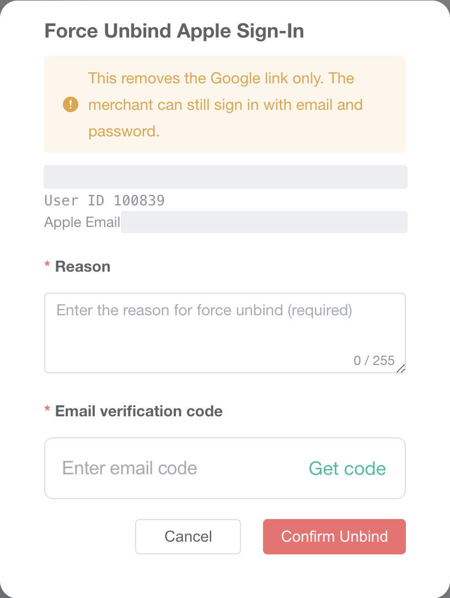

# 管理后台

C 端自己连接、断开在 `02-用户视角`。Android 上没有 Apple 入口。运营这边是另一条：把已经连上的 Apple 账号从商户上摘掉。商户仍可用邮箱和密码登录。这不是账户安全里的动态码，也不是右上角员工自己的 Google Authenticator。

测试环境新后台 `https://test-new-admin.vtron-card.com`。登录的是 Main Admin（`sys_role.role_key = main`）。菜单在 Authority → Apple Bindings，地址 `/system/appleBinding`。银行后台这次没打开。

## 1. 列表

筛选项是 Platform email、Apple email、Bind status（Bound / Unbound）、Bound from、Bound to，旁边 Search。列是 User ID、Email、Apple Sub、Apple Email、Status、Bound At、Last Apple Login。未绑定的商户也在这张表里。刚进页面时一共 927 行，第一页是较新的未绑定账号。Apple Sub 有值时列表里是截断的。

商户 `100985` 在第一页，Status 是 Unbound。Apple Sub 是 `-`，Apple Email、Bound At、Last Apple Login 是 `--`。库里 `merchant_apple_bind` 没有这一行。这一行的操作只有 `View`，没有 `Force Unbind`。

Bind status 选 Bound 之后一共 2 行，User ID `100839`、`100527`。每一行操作都有 `View` 和 `Force Unbind`。`100839` 的 Bound At 是 `2026-09-01 18:26:33`，Last Apple Login 是 `2026-09-01 18:50:02`。`100527` 的 Bound At 是 `2026-09-02 17:16:52`，Last Apple Login 是 `2026-09-17 16:47:18`。

列表权限是 `bu:appleBinding:list` 或 `main:appleBinding:list`。查看是 `bu:appleBinding:query` 或 `main:appleBinding:query`。强制解绑是 `bu:appleBinding:forceUnbind` 或 `main:appleBinding:forceUnbind`。没有对应权限时，行上不拼那一项。这次没有换一个没有该权限的账号再看。

新菜单表 `virtronex_business_admin_protal.admin_menu` 里没有这条。旧表 `virtronex_main.sys_menu` 有 `2764`，菜单名「Apple绑定管理」，`parent_id = 1`，`path = appleBinding`，组件 `security/appleBinding/index`，权限 `bu:appleBinding:list`，`visible = 0`、`status = 0`（这套表里是显示且启用）。`2765` 是查询，`2766` 是强制解绑。角色菜单包含 `2764` 的有 Main Admin、Business User、Agent门户。这次只登录了 Main Admin。界面英文是 “Apple Bindings”。

Customer → Basic Info 行里的 Reset GoogleAuthenticator 归 `06-谷歌验证器`。这次没从那一页进。

## 2. 未绑定的详情

`100985` 点 `View`，标题 “Apple Binding Detail”。User ID `100985`，旁边有复制，这次没点。Registration Method 是 Email，Account Status 是 Normal，Status 是 Unbound。User 一栏有邮箱和 Created At `2026-09-23 00:17:39`，邮箱已打码。Apple Binding 一栏是 “Not connected to Apple Sign-In.”。Binding History 表头是 Time、Event、Operator、Detail，内容 No Data。底下只有 `Close`，没有强制解绑。接口是 `POST /security/appleBinding/detail` 和 `POST /security/appleBinding/logPage`。

## 3. 强制解绑弹窗

在 Bound 的一行（User ID `100839`）点 `Force Unbind`。标题 “Force Unbind Apple Sign-In”。警告英文是 “This removes the Google link only. The merchant can still sign in with email and password.” 写成了 Google。中文文案是 “仅移除 Apple 绑定关系，商户仍可用邮箱和密码登录。” 下面是平台邮箱、User ID、Apple Email，邮箱已打码。Reason 必填，占位 “Enter the reason for force unbind (required)”，计数 `0 / 255`。Email verification code，旁边 `Get code`。`Cancel`、`Confirm Unbind`。这次这个员工没有谷歌码那一格。源码里员工已经绑了验证器，才会多出谷歌码。

没有点 `Get code`，也没有点 `Confirm Unbind`，点了 `Cancel`。弹窗关掉之后这两行仍是 Bound。库里 `merchant_id` 为 `100839` 和 `100527` 的 `status` 仍是 `1`，`deleted` 仍是 `0`。成功提示 “Apple Sign-In unbound” 这次没出现。

`Get code` 走的是员工自己的邮箱，类型 `platformForceUnbindMerchantApple`，接口 `POST /email/sendCheckEmailWithoutEmail`，不是商户邮箱。确认走 `POST /security/appleBinding/forceUnbind`。

## 4. 提交时代码会做什么

这次没有提交。`MerchantAppleBindingServiceImpl.forceUnbind` 先看商户、验证码、原因是否都有，原因去空格后仍为空或长于 255，都是 `merchantAppleForceUnbind.param.required`，英文 “Required parameters are missing.”。商户不在当前数据范围里是 `record.notFound`，英文 “Record not found or operation not permitted.”。没有仍生效的绑定，或解绑时刚好被别人先解掉，都是 `apple.not.bound`，英文 “No Apple account link was found.”，不再写一条日志。

核对操作者验证码之后，`softUnbindByMerchantId` 把这一行改成 `status = 0`、`deleted = id`，显示名和头像清空。`apple_sub`、`apple_email` 留在行上，查询只看 `deleted = 0`。然后往 `merchant_apple_bind_log` 插一行，`event_type = unbind`，`operator_type = admin`，带原因、操作者、IP。控制器注释写明这一步不踢商户在线会话。这次没有提交，所以没有在已登录的客户端上再看。
