# 用户视角

Android `dev`，包 `com.vtron.pay`，模拟器 `emulator-5554`。H5、Web、iOS 这次没打开。

测试商户 `100985`。进来之前库里 `pay_password` 是空的。账号安全页在 `Account` → `Account Security`。

## 1. 还没设过

页头 “Account Protection: Weak”，下面 “Enable securekey to strengthen your security”。`SecureKey` 这一行右侧是橙色 `Enable Now`。没有重置、修改。

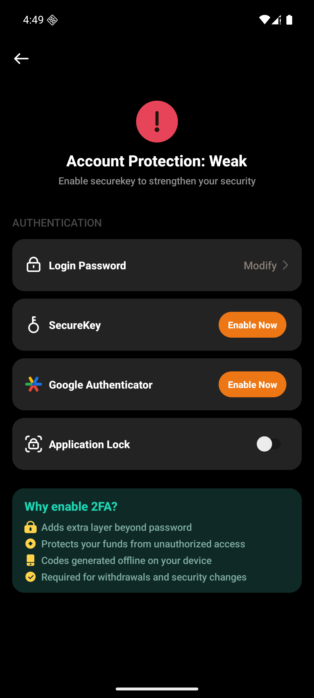

点 `Enable Now`，底部弹出 “SecureKey”。正文 “To perform this action, please set and enter your SecureKey. Tap to set up your SecureKey”。按钮 `Set SecureKey`、`Cancel`。

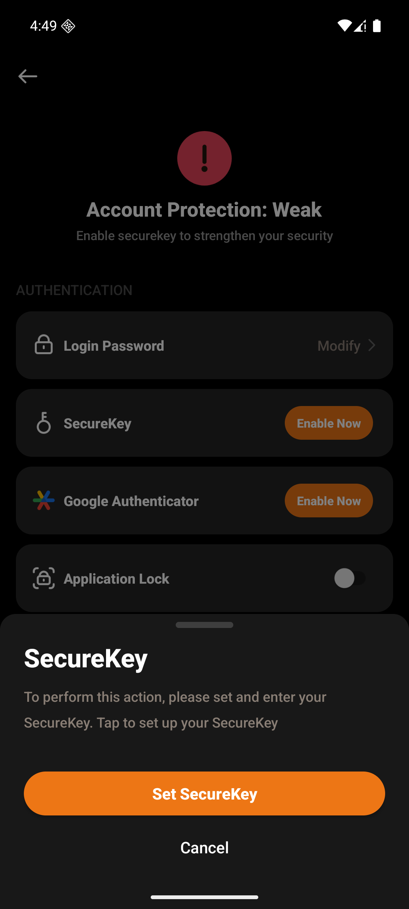

点 `Set SecureKey` 进邮箱验证码页，和 `03-验证码与登录加固` 同一张：标题 “Email Verify”，8 格，`Continue`。地址在这一页上，没有截进笔记。通过后是设密页。请求是 `POST /api/v1/customer/modifyAccessDetails`，`type` 为 `createPayPassword`。页面上没有谷歌码格子。

## 2. 设两位

标题先是 “Setup SecureKey”。6 个圆点，下面是数字键盘。满 6 位后圆点清空，标题变成 “Confirm SecureKey”。

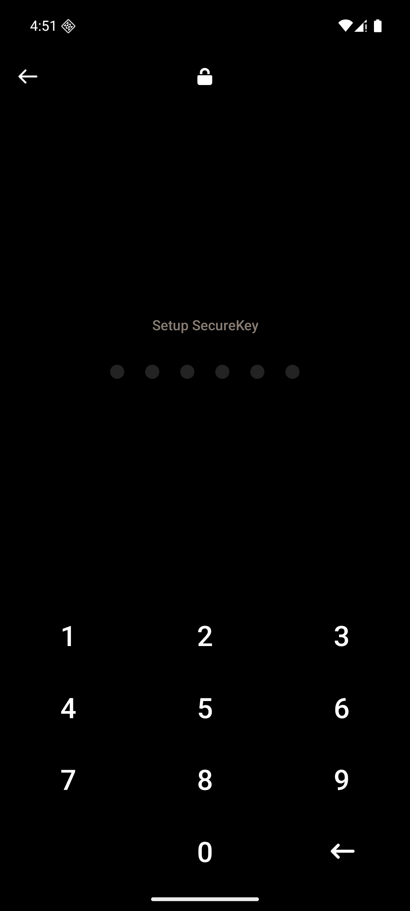

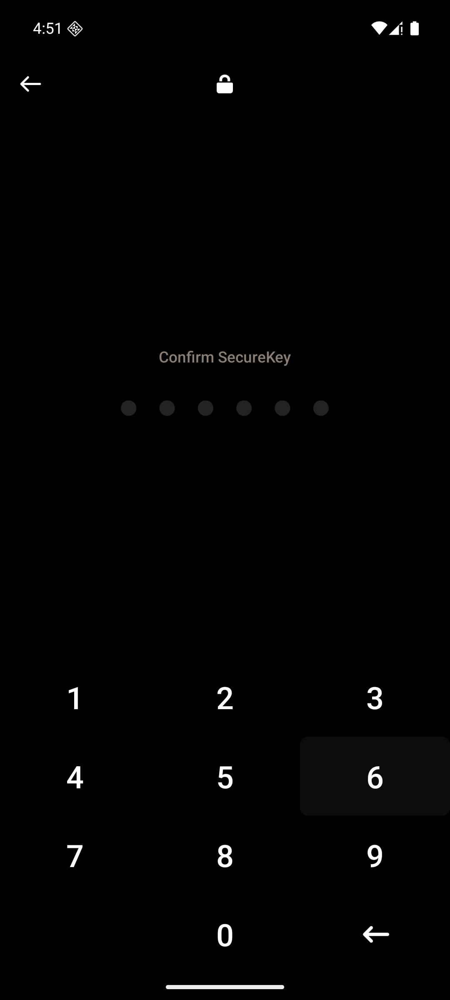

两次不一致，标题变成 “Mismatch, Please Re-enter”，圆点清空，没有发请求。

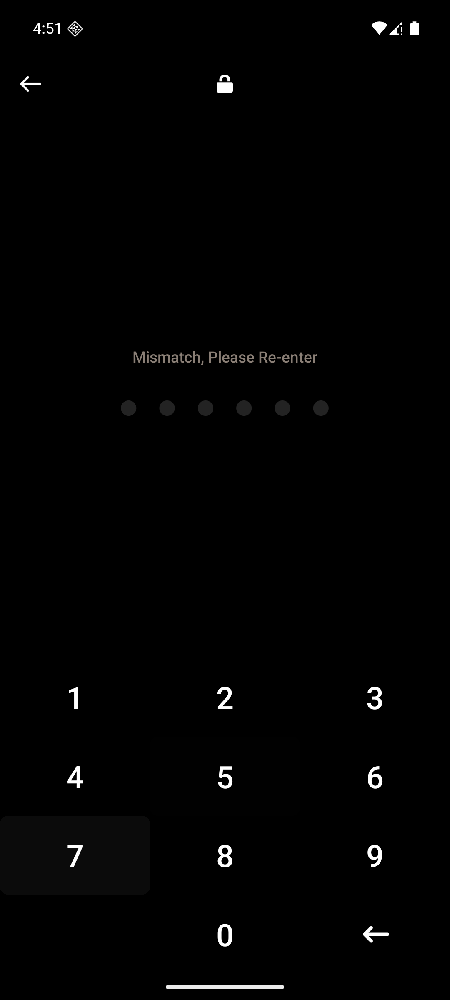

再输入两遍相同的 6 位，回到账号安全。绿条 “SecureKey has been set successfully”。页头变成 “Account Protection: Medium”，“Enable 2FA to strengthen your security”。`SecureKey` 右侧从 `Enable Now` 换成 `Modify`。

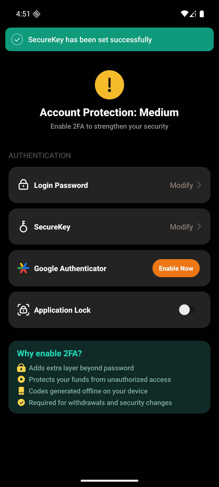

## 3. 已设过：重置

点 `SecureKey` 那一行，下面展开两个按钮：红框 `Reset SecureKey`，灰框 `Modify`。

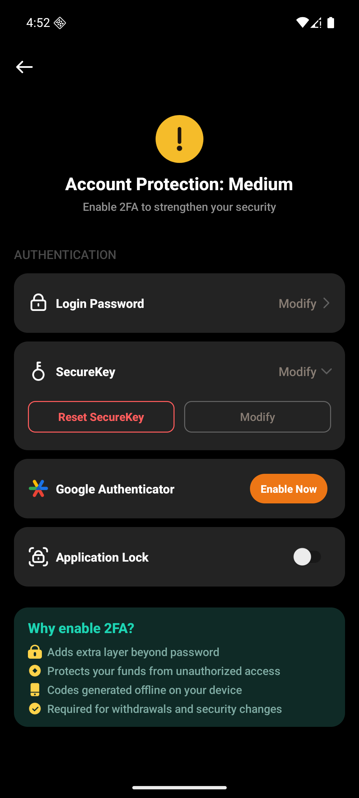

点重置，底部 “Reset SecureKey?”。正文 “This will clear all credentials stored on this SecureKey. After resetting, you will need to re-register the key with your account.” 红按钮 `Confirm Reset`，下面 `Cancel`。

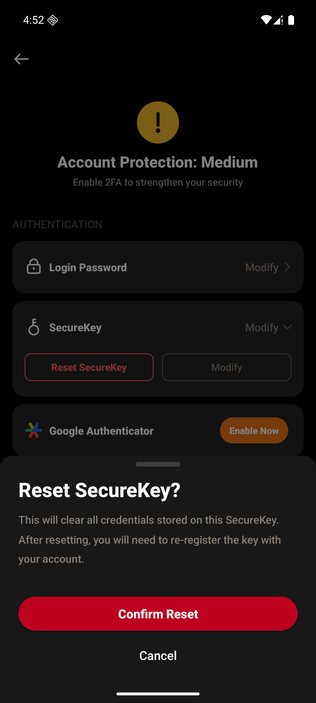

确认后又是同一张邮箱验证码页，通过后还是第 2 节那张设密页。这次 `type` 是 `resetPayPassword`。两遍一致后不是绿条，而是单独一页：绿勾，“Security Password Reset”，“Your security password has been successfully reset”，底部 `Done`。`Done` 回到账号安全。

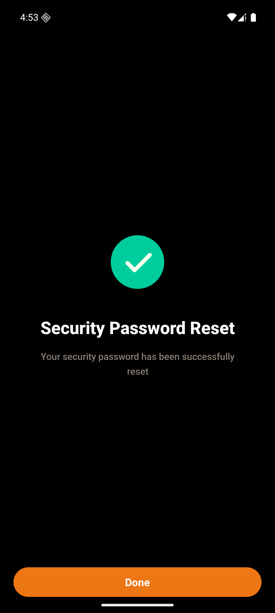

## 4. 修改先校验

展开后点灰框 `Modify`，进入 `VerifySecureKeyActivity`。标题 “Enter SecureKey”，仍是 6 个圆点。下面一块 “Forgot your SecureKey?”、“Reset It”。这一块点开会出和第 3 节同一张重置确认，这次没有再点。

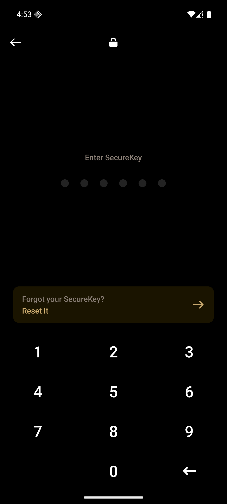

输入一串不对的 6 位。请求是 `POST /api/v1/auth/check/verifyPayPassword`。圆点清空，红字 “4 attempts remaining”，停在这一页，没有吐司。只错了这一次，没有继续错到锁定。

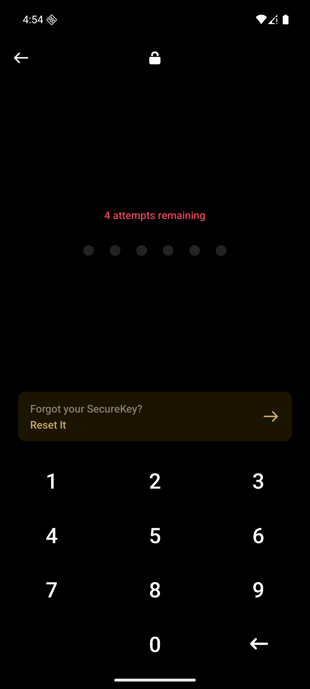

校验通过后源码会再进邮箱验证码，`type` 为 `updatePayPassword`，成功吐司是 “SecureKey has been modified successfully”。这次停在错误这一下，改密后半段没走。

## 5. 稿

介绍里的 `12323:16760` 画布名是 “20.✅ Reset SecureKey”，`10822:740` 画布名是 “14. ✅ 新注册用户-KYC/交易密码提示”。两张都是 0×0，截图是黑的，对不上上面这些页。

## 6. 这次没走

- 开卡、卡详情那些入口上的校验页。账号安全里的修改已经打开同一张校验页
- 改密在校验通过之后的验证码和设密
- H5、Web、iOS
