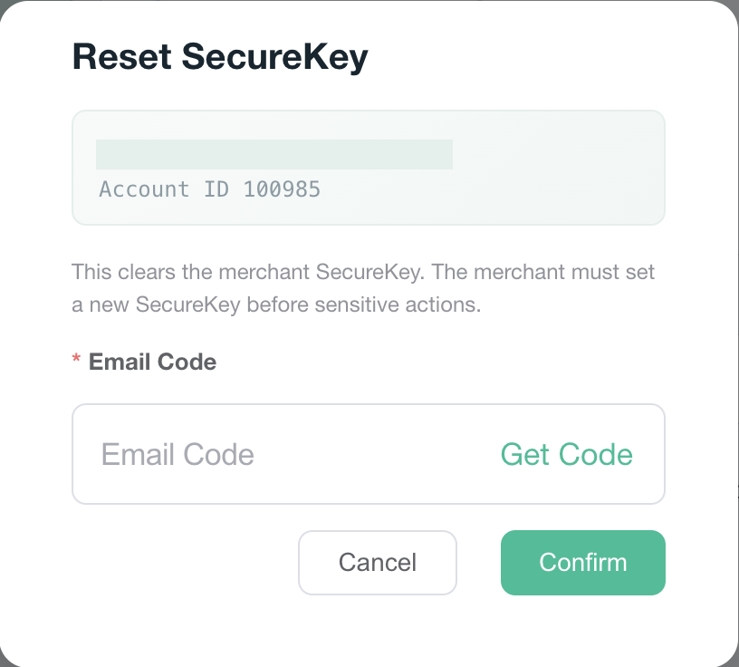

# 管理后台

C 端自助设置、修改、重置在 `02-用户视角`。运营这边是另一条：把商户已经设过的 SecureKey 清掉，不是代商户填一把新的 6 位。

测试环境新后台 `https://test-new-admin.vtron-card.com`。登录的是 Main Admin（`sys_role.role_key = main`）。菜单在 Customer → Basic Info，地址 `/userManage/basicInfo`。银行后台这次没打开。`virtronex_bank_service` 里没有 `resetPayPassword`。

## 1. 行操作

用商户 `100985` 搜出来一行。行尾操作里有 `Edit`、`Change BU`、`Reset SecureKey`。这一行没有谷歌验证器，所以没有重置谷歌验证器。`Invite bank account` 也没有，那一行的银行功能不是开的。

`Reset SecureKey` 靠权限 `bu:merchantAddPoint:resetPayPassword`。没有这个权限时，行操作里不拼这一项。这次没有换一个没有该权限的账号再看。

新菜单表 `virtronex_business_admin_protal.admin_menu` 里没有这条权限。旧表 `virtronex_main.sys_menu` 有 `2090`，菜单名「重置支付密码」，挂在「用户信息」`2053` 下面，`visible = 0`、`status = 0`（这套表里是显示且启用）。Main Admin 的角色菜单包含 `2090`。界面英文是 “Reset SecureKey”。

## 2. 弹窗

点 `Reset SecureKey` 后弹出确认。标题 “Reset SecureKey”。上面是商户邮箱和 Account ID，邮箱已打码。说明是 “This clears the merchant SecureKey. The merchant must set a new SecureKey before sensitive actions.” 下面要填 Email Code，旁边 `Get Code`。`Cancel`、`Confirm`。这次这个员工没有谷歌码那一格。源码里员工已经绑了验证器，才会多出谷歌码。

没有点 `Get Code`，也没有点 `Confirm`。成功提示 “SecureKey reset successfully” 这次没出现。库里 `merchant.pay_password` 仍在，没有被清掉。

`Get Code` 走的是员工自己的邮箱，类型 `platformResetMerchantPayPassword`，不是商户邮箱。确认走 `POST /merchantAddPoint/resetPayPassword`，权限同上。服务在 `MerchantPayPasswordResetServiceImpl.resetPayPassword`：核对操作者验证码之后，把 `merchant.pay_password` 写成 `NULL`，并删掉这名商户的校验失败键和锁定键。不写新的 6 位。C 端下次再进账号安全，会回到未设置时的 `Enable Now`。这次没有提交，所以手机上那一页没有再打开核对。
