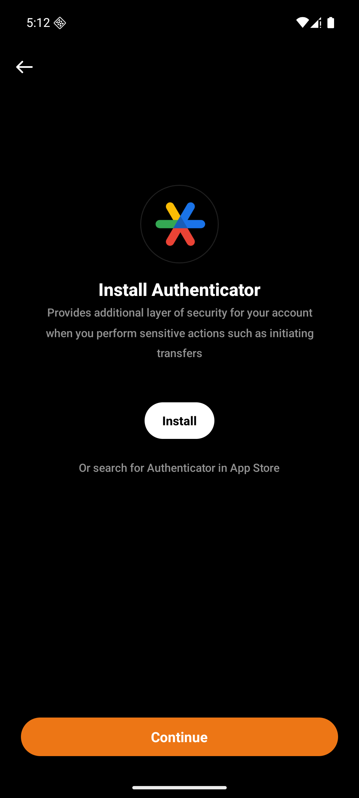
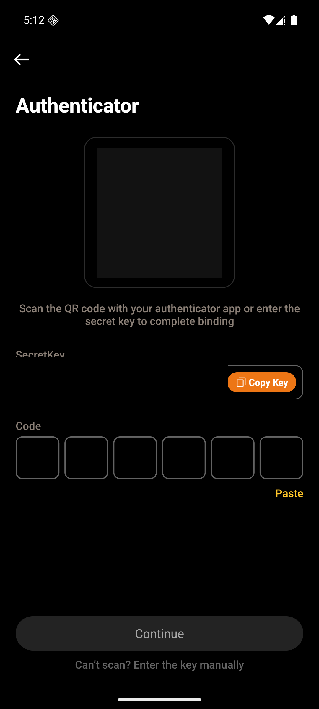
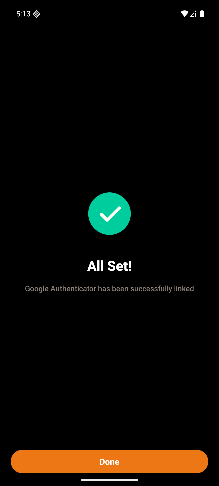
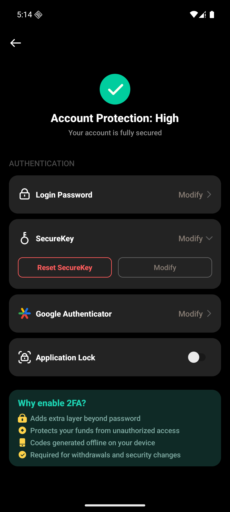
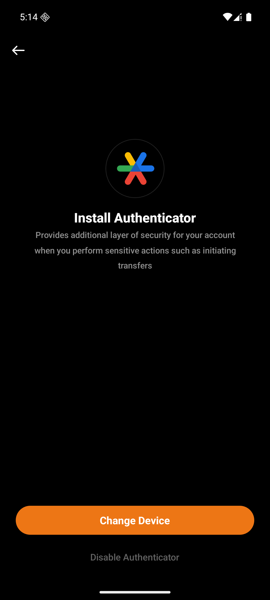
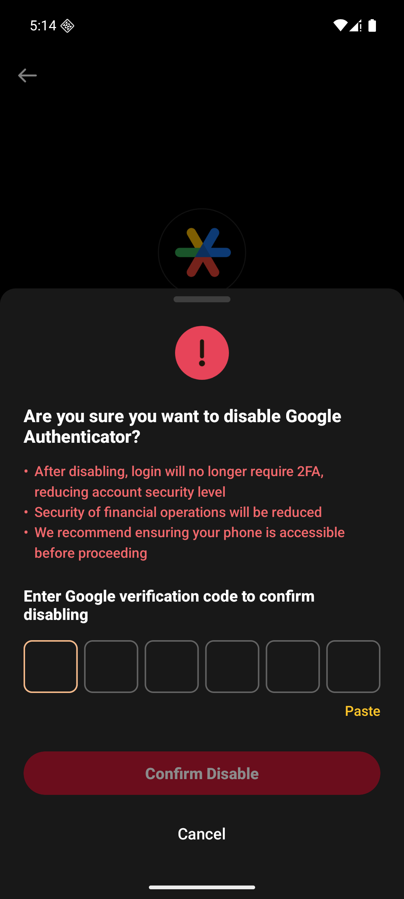
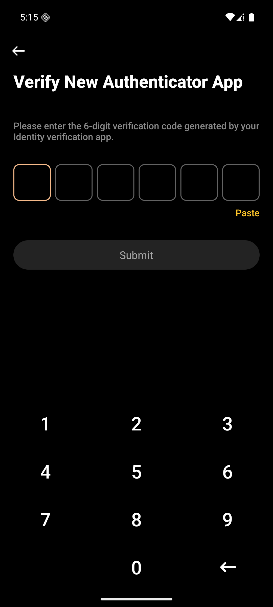

# 用户视角

Android `dev`，包 `com.vtron.pay`，模拟器 `emulator-5554`。H5、Web、iOS 这次没打开。

测试商户 `100985`。进来之前账户安全上 Google Authenticator 是 `Enable Now`。账号安全页在 `Account` → `Account Security`。

## 1. 还没绑定

点 `Enable Now` 进入 `InstallGoogleAuthenticatorActivity`。标题 “Install Authenticator”。说明是 “Provides additional layer of security for your account when you perform sensitive actions such as initiating transfers”。中间白按钮 `Install`，下面 “Or search for Authenticator in App Store”。底部 `Continue`。`Install` 会去应用商店，这次没点。

`Continue` 不要求本机已经装上验证器，直接进绑定页。

## 2. 扫码绑定

标题 “Authenticator”。说明 “Scan the QR code with your authenticator app or enter the secret key to complete binding”。中间是二维码，下面 “SecretKey” 和 `Copy Key`，再下面 6 格和 `Paste`。没满 6 位时 `Continue` 是灰的。最下面 “Can’t scan? Enter the key manually”。二维码和密钥已打码。这一步是 `POST /api/v1/google/getQrcode`，密钥还没写入。

填上当前 6 位动态码再点 `Continue`，请求是 `POST /api/v1/googleVerify/save`，`googleStatus` 为 `3`。成功是单独一页：绿勾，“All Set!”，“Google Authenticator has been successfully linked”，底部 `Done`。

`Done` 回到账号安全。页头变成 “Account Protection: High”，“Your account is fully secured”。Google Authenticator 右侧从 `Enable Now` 换成 `Modify`。

## 3. 已开启：换设备和关闭

点这一行，还是安装那一页，但没有 `Install` 和商店那句。底部按钮是 `Change Device`，再下面 “Disable Authenticator”。

点 “Disable Authenticator”，底部弹出 “Are you sure you want to disable Google Authenticator?”。三条红字：关掉后登录不再要 2FA、资金操作的安全性会降低、建议先确认手机还在手边。下面 “Enter Google verification code to confirm disabling”，6 格，`Paste`，红按钮 `Confirm Disable`，`Cancel`。这一页只收动态码，没有邮箱码。这次点了 `Cancel`，没有提交。确认走的是 `googleVerify/save`，`googleStatus` 为 `0`。

点 `Change Device` 进入 `VerifyGoogleAuthenticatorActivity`。标题是 “Verify New Authenticator App”，说明 “Please enter the 6-digit verification code generated by your Identity verification app.”。6 格、`Paste`、灰的 `Submit`，下面是数字键盘。这一步校验的是旧设备上的动态码，接口是 `POST /api/v1/google/checkCode`。通过之后才会再开和第 2 节一样的二维码页，带上旧码去换设备。这次没有点 `Submit`。

## 4. 这次没走

- 换设备在旧码通过之后的新二维码和成功页
- 关闭提交之后的 “Google Authenticator Disabled”
- 别的资金动作上的安全验证页。账户安全里没有单独再开一页只做预检
- H5、Web、iOS
- 目录里账户安全的稿没有单独 node，这次没有对上某一帧
