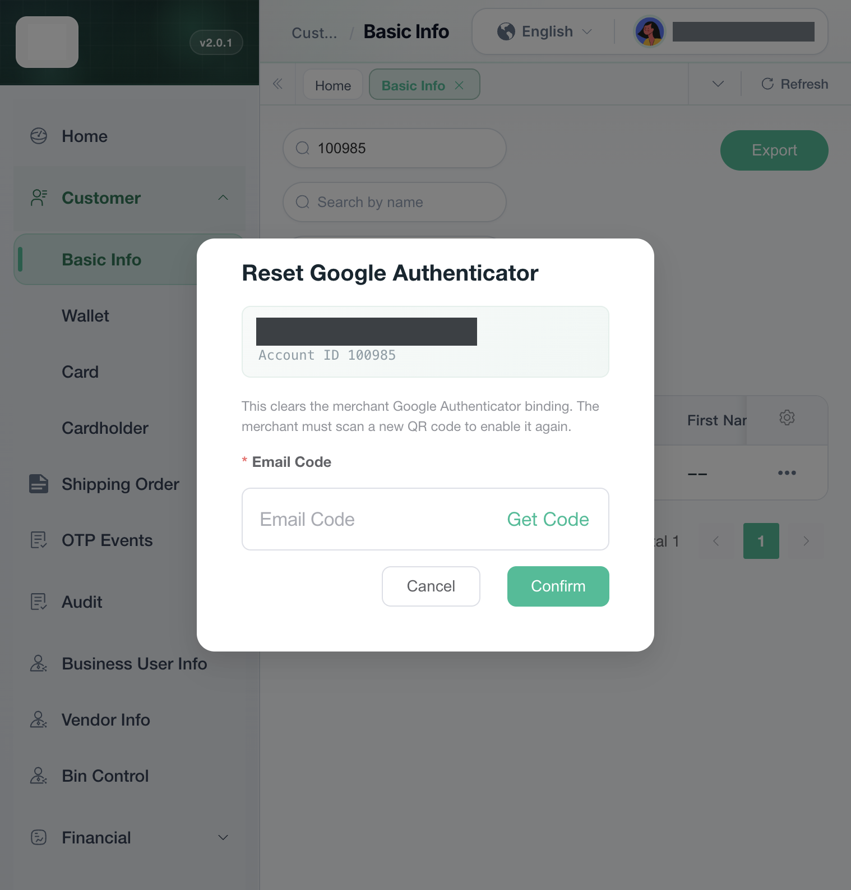

# 管理后台

C 端自己绑定、换设备、关闭在 `02-用户视角`。运营这边是另一条：把商户已经开启的 Google Authenticator 清掉，不是代商户扫一个新码。

测试环境新后台 `https://test-new-admin.vtron-card.com`。登录的是 Main Admin（`sys_role.role_key = main`）。菜单在 Customer → Basic Info，地址 `/userManage/basicInfo`。银行后台这次没打开。`virtronex_bank_service` 里没有 `resetGoogleAuthenticator`。

## 1. 行操作

用商户 `100985` 搜出来一行。这一行已经开启验证器（`google_verify.type = 2` 且 `google_status = 1`）。行尾操作里有 `Edit`、`Change BU`、`Reset SecureKey`、`Reset GoogleAuthenticator`。`Invite bank account` 没有，那一行的银行功能不是开的。

列表是否带上这一项，看 `MerchantAddPointSlaveMapper.selectPageList` 里的 `googleAuthenticatorSet`：存在 `type = 2` 且 `google_status = '1'` 的 `google_verify` 才为真。没开启时行操作不拼这一项。权限是 `bu:merchantAddPoint:resetGoogleAuthenticator`。没有这个权限时也不拼。这次没有换一个没有该权限的账号再看。

新菜单表 `virtronex_business_admin_protal.admin_menu` 里没有这条权限。旧表 `virtronex_main.sys_menu` 有 `2091`，菜单名「重置谷歌验证器」，挂在「用户信息」`2053` 下面，`visible = 0`、`status = 0`（这套表里是显示且启用）。角色菜单包含 `2091` 的有 Main Admin、Business User、Agent门户。这次只登录了 Main Admin。界面英文是 “Reset GoogleAuthenticator”。

侧栏 Authority 里的 Google Bindings，以及右上角账号菜单里的 Google Authenticator，都不是这一行。这次没打开。账号登录的绑定页归 `04-第三方登录`。

## 2. 弹窗

点 `Reset GoogleAuthenticator` 后弹出确认。标题 “Reset Google Authenticator”。上面是商户邮箱和 Account ID，邮箱已打码。说明是 “This clears the merchant Google Authenticator binding. The merchant must scan a new QR code to enable it again.” 下面要填 Email Code，旁边 `Get Code`。`Cancel`、`Confirm`。这次这个员工没有谷歌码那一格。源码里员工已经绑了验证器，才会多出谷歌码。

没有点 `Get Code`，也没有点 `Confirm`。成功提示 “Google Authenticator reset successfully” 这次没出现。库里这一行 `google_status` 仍是 `1`，密钥还在，没有被清掉。

`Get Code` 走的是员工自己的邮箱，类型 `platformResetMerchantGoogle`，接口 `POST /email/sendCheckEmailWithoutEmail`，不是商户邮箱。确认走 `POST /merchantAddPoint/resetGoogleAuthenticator`，权限同上。服务在 `MerchantGoogleAuthenticatorResetServiceImpl.resetGoogleAuthenticator`：核对操作者验证码之后，把这名商户 `type = 2` 且仍是开启的那一行改成 `google_status = 0`，密钥、绑定时间、绑定设备、上次验证时间都写成空，行留下。改不到恰好一行时是 `google.notEnabled`，英文 “Google Authenticator is not enabled.”。不写 `google_verify_log`。C 端下次再进账号安全，会回到未绑定时的 `Enable Now`。这次没有提交，所以手机上那一页没有再打开核对。
