# 用户视角

Android `dev`，包 `com.vtron.pay`，模拟器 `emulator-5554`（`virtronex_api36`）。这次 `git pull` 已是最新，`b294183`（2026-11-10）。卡平台 `dev` 是 `8563250ca`（2026-11-16）。H5、Web、iOS 这次没打开。

钱包首页余额是 0.00。跳过通知页之后，底部弹出准备做 KYC。这一步还没进国籍表单，也还没到确认页。

## Get Ready

标题 “Get Ready”。正文 “Complete your quick KYC verification to unlock card creation and all other services. Verifying your identity helps us protect your account from fraud and keeps your data secure.” 橙按钮 `I'm Ready`，下面 `Cancel`。这句是客户端本地文案，这一步没有发 KYC 接口。

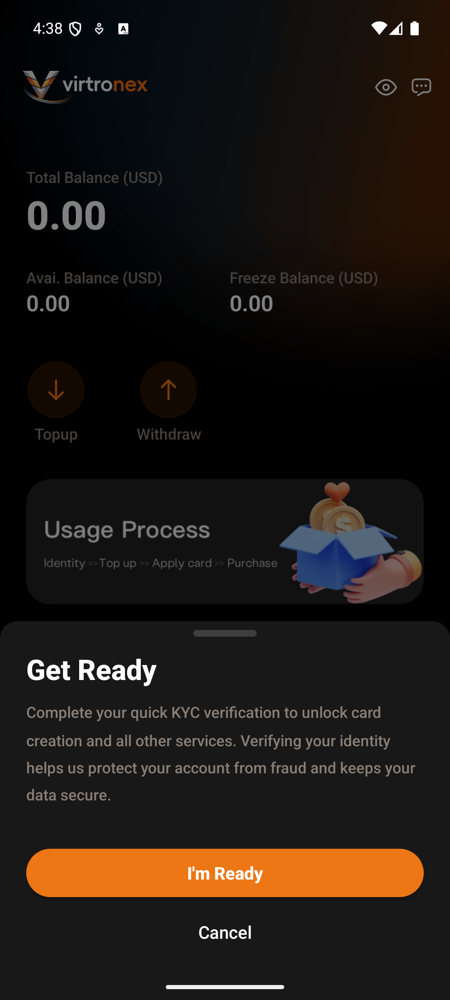

点 `I'm Ready` 进入选卡。`Cancel` 这次没点。

## Choose Your Card

标题 “Choose Your Card”。第一张卡名 `9P1`。KYC 这一行是 “ID/Passport, Selfie”，右边橙按钮 `Go for KYC`。卡面上 Apply Fee 是 `10.00 USD`，Monthly Fee 是 `10.00 USD`。这一步没有扣款。费用怎么算归 `08-开卡`。

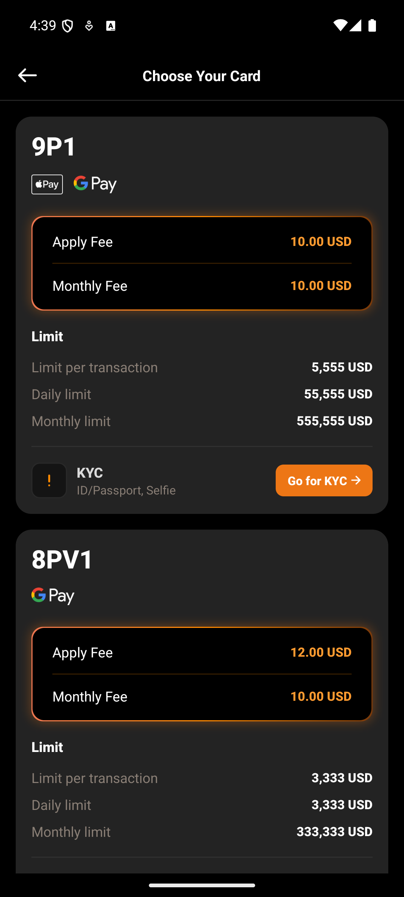

下面还有一张 `8PV1`，这次没点它的按钮。点 `9P1` 的 `Go for KYC` 后，选卡页上盖出证件类型。

## ID Type

标题 “ID Type”。两行：`ID Card`、`Passport`，右边都是空心圆。底部 `Continue` 是灰的。没选时点 `Continue`，还停在这一页，没有发请求。

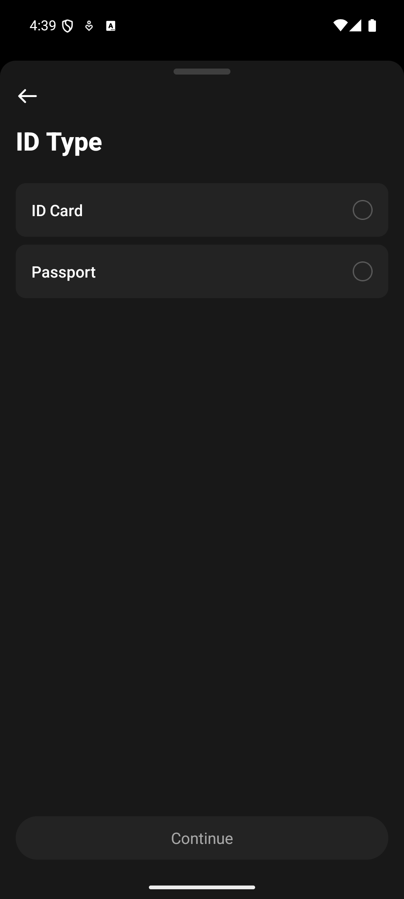

点 `ID Card`，这一行变成棕底橙勾，`Continue` 变成橙色。`Passport` 这次没再选。

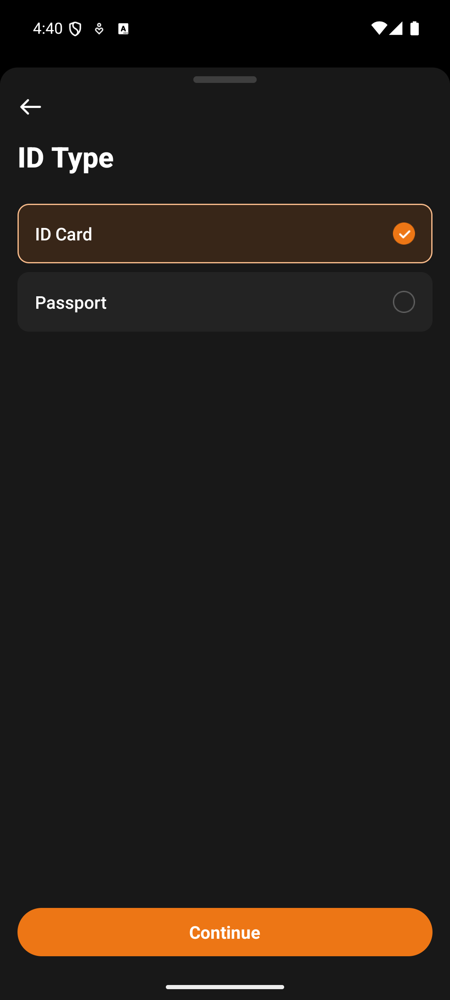

点橙色 `Continue`，再盖上一张正面提示。这一步仍不发请求。

## Front of ID Card

标题 “Front of ID Card”。说明 “\*Upload in JPG or PNG format. Image size must not exceed 5MB.” 下面两句是 “Avoid Glare”、“Stay Sharp”。按钮 `Upload`、`Take Photo`。这些是本地文案。

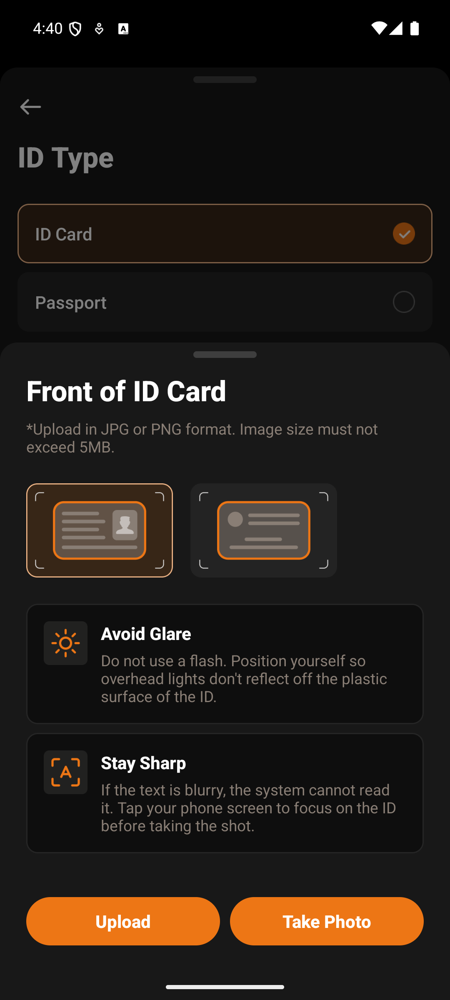

## Allow Virtronex to take pictures and record video?

点 `Take Photo`，系统先问相机权限。三个选择：`While using the app`、`Only this time`、`Don't allow`。点了 `While using the app`。

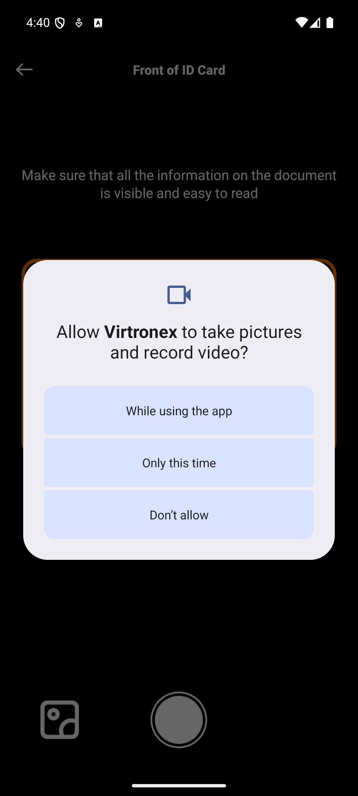

## Make sure that all the information on the document is visible and easy to read

权限通过后是取景页，标题 “Front of ID Card”，说明是这句。中间是橙色横框。模拟器预览是虚拟场景，不是证件。下面是相册和快门。

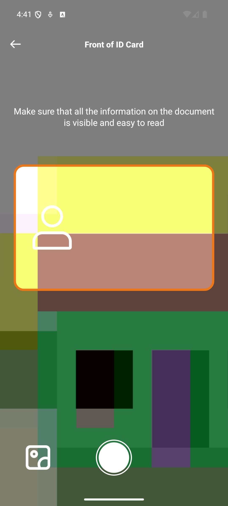

## Please retake or upload a clear front of your ID photo

按下快门后停在拍摄结果页。预览是刚拍的虚拟场景。底部标题 “Recognition failed”，正文是这句。按钮 `Upload`、`Take Photo`。

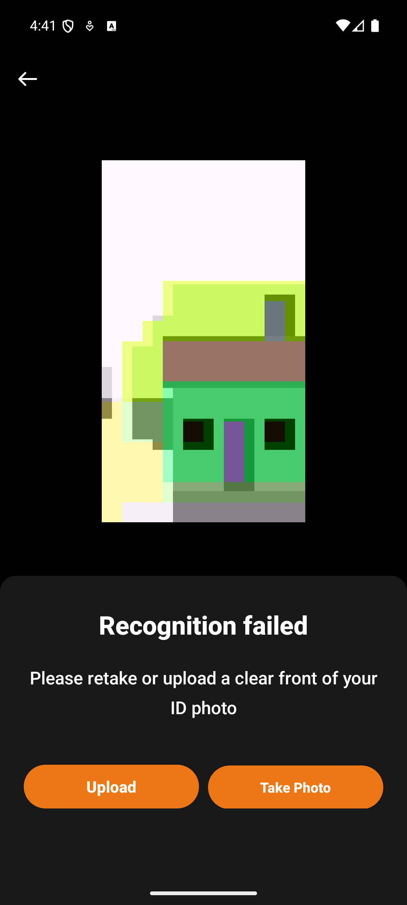

这句是客户端本地文案，不是接口 `msg`，页面也不展示 `ocr.tip`。请求是 `POST /api/v1/upload/kyc/file/ocr`，走的是身份证正面。响应 `code` 为 200，`ocr.status` 是 `NOT_ID_DOCUMENT`，`tip` 是 “Please upload the front.”。`fileUrl` 有值，但 status 不是 `SUCCESS` 或 `SKIPPED`，所以不进背面或编辑页。签名见 `19-OpenAPI会话`。

## No photos yet

结果页再点 `Upload`，打开系统相册。标题 “Photos”，中间 “No photos yet”，“Start capturing photos and videos”。相册是空的，没有选中一张图，也就没有再发上传。

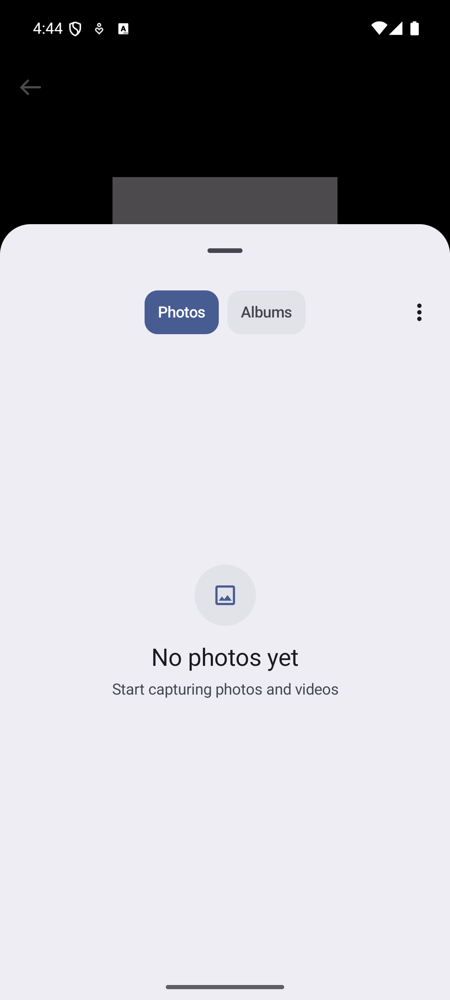

## 稿

介绍里的 `6519:37056` Card-KYC、`13982:2542` KYC 3、`10822:740` 这次没对帧。

## 这次没走

- 国籍、编辑页、确认页。正面没通过，客户端不往下走
- `Passport` 选中之后的提示和拍摄
- `Get Ready` 的 `Cancel`，以及 `8PV1`
- H5、Web、iOS

## GO

账户页商户 `100985`。邮箱在屏幕上已经打码。`Identity Verification` 这一块右侧是 `GO`。这是客户端拿已有用户资料里的 KYC 状态判断的：没交过是 `7`。这一步没有新的提交接口。

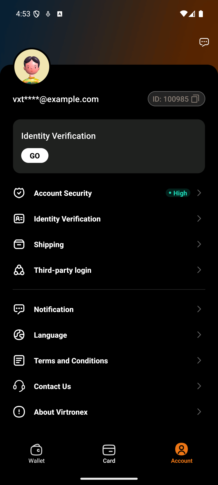

点下面菜单里的 `Identity Verification`，又弹出第 1 次见过的 `Get Ready`，没有进审核记录页。

## Spend with Care

卡页没有已开的卡。标题 “Anytime, Anywhere”“Spend with Care”。说明 “Create card in seconds - virtual or physical, designed for seamless global spending”。两个按钮：`Choose Your Card`、`Activate Physical Card`。页面上没有 Pending、Approved、Reject。

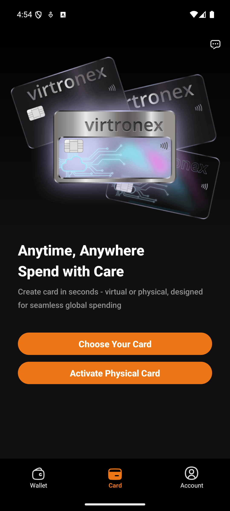

## Virtual Card

选卡列表再往下。`8PV1` 的 KYC 角标是 “ID/Passport”，和 `9P1` 的 “ID/Passport, Selfie” 不一样。再下面一张卡名是 “Virtual Card”。Apply Fee 是 `12.00 USD`，Monthly Fee 是 `10.00 USD`。单笔、每日、每月限额都是 “-- USD”。KYC 角标也是 “ID/Passport”，按钮仍是 `Go for KYC`。

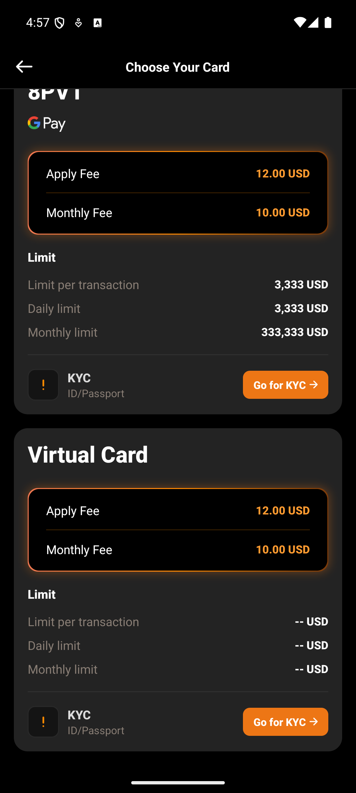

列表请求是 `POST /api/v1/card/choices`，body 里带 `binFlow` 为 `ENHANCED`。第三张响应里的 `binFlow` 才是 `ENHANCED`，前两张是空的。屏幕上没有 ENHANCED，也没有 KYC3。

点 “Virtual Card” 的 `Go for KYC`，盖出的仍是上次那张 `ID Type`。没有进编辑页，也没有 “Proof of Address”。

## 地址证明和确认页

这次没打开。居住地址按国籍自动生成仍没有业务代码：Java 里没有读写 `t_kyc_resident_address_seed` 的类。见 `04-代码分析` 里地址证明那几节。

## 通过后不自动出卡

`docs/product-alignment/KYC通过后自动开卡-备忘.md` 文首写未编码、未排期。`docs/INDEX.md` 写未实施。这次对过卡平台 `dev` `8563250ca`：`AuditKycBuServiceImpl.applyAuditLocked` 通过时只调 `createSingleByBin` 建持卡人，再 `CardHolderPairFillService.ensurePeerAfterApproved` 补对端持卡人。两处都不写 `merchant_card`，也不调 `createCards`。提交路径 `MerchantKycServiceImpl` 同样不调开卡。用户要自己再走 `POST /api/v1/card/createCards`，归 `08-开卡`。

这一户还没交资料，卡页没有卡，不能当成通过之后的界面。审核中、通过、拒绝这三张都没在这一户上出现。
