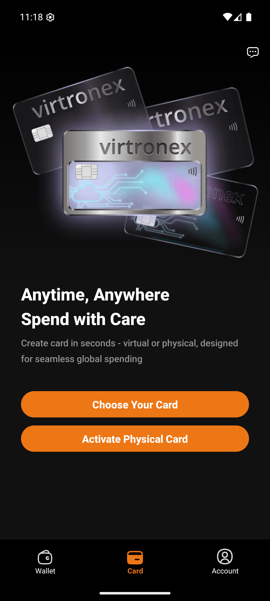
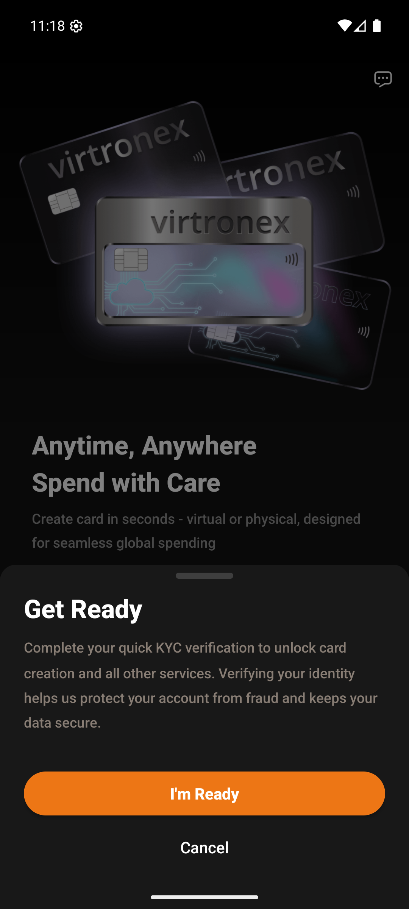
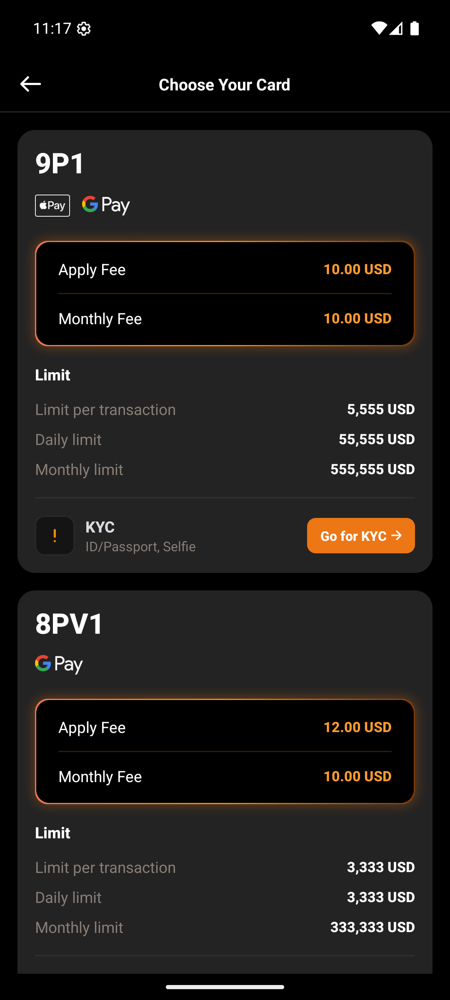
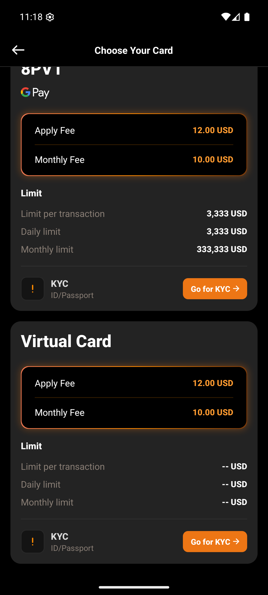

# 用户视角

Android `dev`，包 `com.vtron.pay`，模拟器 `emulator-5554`（`virtronex_api36`）。这次 `git pull` 已是最新，`b294183`（2026-11-10）。卡平台 `dev` 是 `c61f995c7`（2026-11-18）。H5、Web、iOS 这次没打开。

商户 `100985`。卡页没有卡。钱包是 0.00，这次没再进钱包页。

## 没有卡

卡页标题 “Anytime, Anywhere Spend with Care”。下面一句 “Create card in seconds - virtual or physical, designed for seamless global spending”。两个橙按钮：`Choose Your Card`、`Activate Physical Card`。这一页没有卡号，也没有发开卡接口。

两个按钮点下去都是同一张准备框，这一步没有请求。`Activate Physical Card` 点完用 `Cancel` 关掉，还停在卡页。

## Get Ready

标题 “Get Ready”。正文 “Complete your quick KYC verification to unlock card creation and all other services. Verifying your identity helps us protect your account from fraud and keeps your data secure.” 橙按钮 `I'm Ready`，下面 `Cancel`。这句是客户端本地文案。

点 `I'm Ready` 进入选卡。

## Choose Your Card

标题 “Choose Your Card”。请求是 `POST /api/v1/card/choices`，body 里 `binFlow` 是 `ENHANCED`。响应 `code` 为 200，三张卡。`cardHolderStatus` 都是空。按钮不看这个字段，三张都是 `Go for KYC`。这一步没有扣款。

第一张卡名 `9P1`。Apply Fee `10.00 USD`，Monthly Fee `10.00 USD`。限额一行是 5,555 / 55,555 / 555,555 USD。KYC 这一行是 “ID/Passport, Selfie”。

往下是 `8PV1`。Apply Fee `12.00 USD`，Monthly Fee `10.00 USD`。限额是 3,333 / 3,333 / 333,333 USD。KYC 这一行是 “ID/Passport”。

第三张没有卡名，页面写成 “Virtual Card”。Apply Fee `12.00 USD`，Monthly Fee `10.00 USD`。三行限额都是 “-- USD”。KYC 这一行也是 “ID/Passport”。响应里这张 `binFlow` 是 `ENHANCED`，前两张是空。

屏幕上的 Apply Fee 是基础费加 `applyCard`。`9P1` 的基础费是 0，后两张是 2，加点都是 10。金额怎么入账见上面的代码分析。

点第三张的 `Go for KYC`，只发 `POST /api/v1/KYC/profileFields`，`binConfigId` 是 `9`，响应 `code` 为 200。接着盖上证件类型，`Continue` 是灰的。没有 `applyPreview`，也没有 `createCards`。证件页归 `07-KYC与持卡人`。这次没有再点 `Continue`。

## 稿

介绍里的 `6246:15878`、`12879:2834` Card-Create 这次没对帧。

## 这次没走

- 余额够不够的确认，以及余额不足页。这个商户没交过 KYC，首页不请求 `applyPreview`
- 交易密码页和 `createCards`
- `/bins` 那张按持卡人状态换确认按钮的选卡页
- H5、Web、iOS
