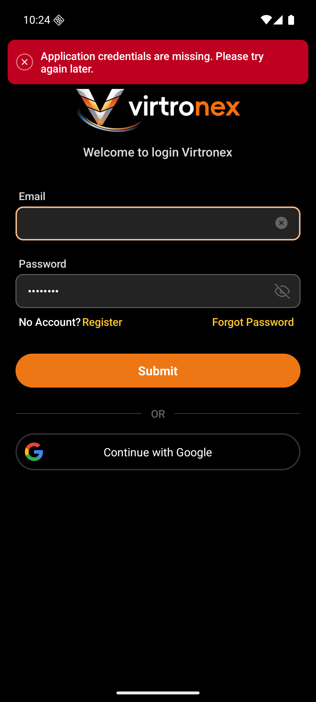

# 用户视角

没有单独的签名页。Android `dev`，包 `com.vtron.pay`，渠道 virtronex、环境 tst。H5、Web、iOS 不跑。

用户自己点退出，见 `02-邮箱注册登录`。这里只写验签和会话失效时停在哪。

## 1. 请求没带上 app id

第一包没有 `openapi/virtronex.properties`，`OpenApiInterceptor` 发现 app id 或 secret 为空，请求不签名、不加密，原样发出。服务端 HTTP 200、业务码 `30005`，英语 “Application credentials are missing. Please try again later.”

登录点 `Submit`、注册勾上协议，都停在原页，顶部红条就是这句。截图在 `02-邮箱注册登录`。

## 2. 签上了但验签失败

第二包补了凭证之后，注册、登录、重置都走通了，没有再看到 `30005`。时钟超窗、nonce 重用、签名对不上，服务端仍是 HTTP 200 加 `30005`。Android 把非 401 的业务码做成顶部提示，不退出登录。这几种文案这次没在模拟器上点出来。

## 3. 会话失效

服务端对没有 Bearer、会话不在、设备或平台对不上、被新登录顶掉，都回 HTTP 401，body 里 `code` 为 `401`。

Android `ErrorInfo` 看到码 `401` 或 `424` 时，不用服务端那句 “Login required or token is invalid”。它清本地登录态，回到 `LoginActivity`，弹窗标题 “Login has expired”，正文用本地文案 “Login status is invalid, please log in again”。已经不在登录态时直接返回，不再弹。

这次模拟器没有制造过期或顶号，弹窗没看到。

Figma 页 `0:1` 上有 “Login has expired”（`158:1820`）。没有单独的签名页。

## 4. 本机加密失败

请求加密失败或响应解不开时，拦截器自己造一个 HTTP 200，码是 `-1002` 或 `-1003`，文案是 “Request encryption failed. Please try again later.” 或 “Response decryption failed. Please try again later.”。同样只提示，不退出。这次没走到。

## 本步没有

- 验签失败、会话 401、本机加解密失败的界面。只看到缺 app id 那一条红条
- H5、Web、iOS
