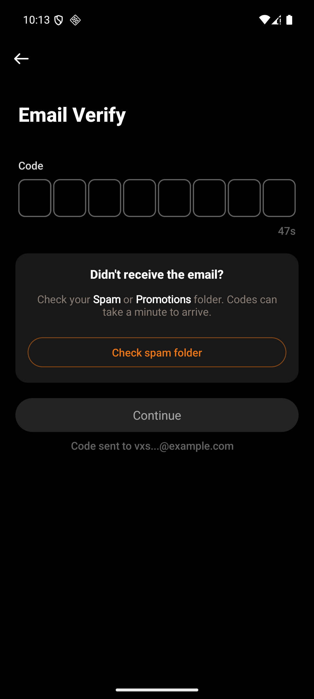
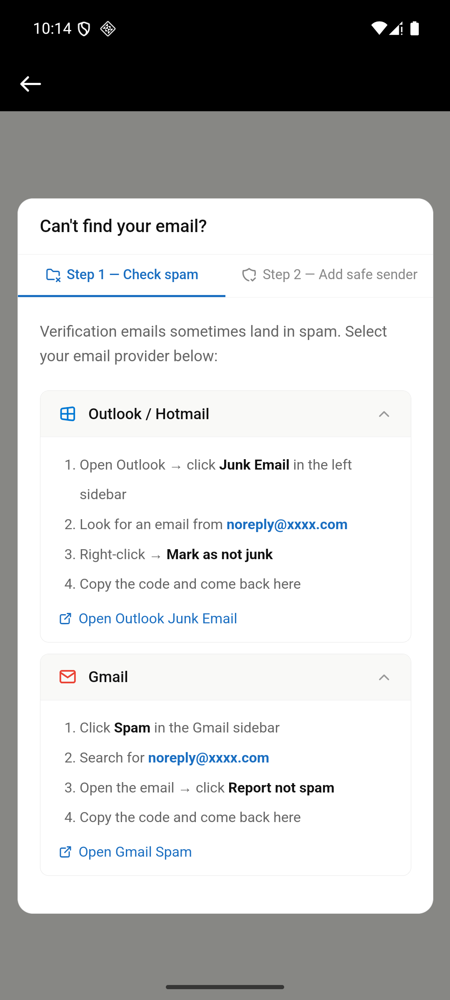

# 用户视角

Android `dev`，包 `com.vtron.pay`，模拟器 `emulator-5554`。2026-09-23 `git pull` 已是最新，`34dba65`。H5、Web、iOS 不跑。信本身不在 App 里，这一遍没有打开收件箱，模板正文留到第二遍。

App 里能看到的是发码之后的 `Email Verify`。登录、注册、重置、改密、交易密码、以及还要邮箱码的 Google/Apple 连接，进的是同一张页。8 格怎么填、输错怎么锁，见 `03-验证码与登录加固`。

## 1. 注册发码之后

登录页点 `Register`，填一个库里还没有的邮箱，公司码空着。点 `Continue`，弹出 “Agree to Terms”，点 `Agree and Continue` 进入 `Email Verify`。一进来就发注册信。没有把 8 位码提交，`merchant` 里没有这行。

发完之后页面留着。右侧倒计时从 60 秒起。没填满时 `Continue` 是灰的。邮箱打码，文案 “Code sent to vxs...@example.com”。

中间一块只在登录和注册、并且接口带回 `senderDomain` 时出现：

- “Didn't receive the email?”
- “Check your Spam or Promotions folder. Codes can take a minute to arrive.” `Spam`、`Promotions` 是白字。这次没点这两个词
- 橙字按钮 `Check spam folder`

倒计时走完变成黄色 `Resend`。再点一次，倒计时重新从 60 秒起。绿条 “Verification code sent successfully” 在上一轮登录发码里出现过，这次重发时截图已经过了那一下。

交易密码进过同一张页，见 `05-交易密码`，当时没有这张卡片。改密、Google/Apple 的连接和断开，这次没有再从账号安全点。验证器的绑定、换设备、关闭，Android 上不进这张发码页，见 `06-谷歌验证器`。

## 2. 找不到邮件

点 `Check spam folder` 打开 WebView，地址是 `https://file.virtronex.com/static/cant-find-email-prototype.html`，后面带 `platform=android` 和发信域名。

标题 “Can't find your email?”。两个标签：“Step 1 — Check spam” 和 “Step 2 — Add safe sender”。这次停在第一步。Outlook / Hotmail 和 Gmail 都展开了，要找的发件人写成 `noreply@xxxx.com`。下面还有 “Open Outlook Junk Email”、“Open Gmail Spam”。第二步没点开。

## 3. 这次没走

- 收件箱里的信。主题和正文留到第二遍
- 改登录密码、交易密码修改、Google/Apple 连接这几条在模拟器上再发一次。页面和上面同一张，卡片只给登录和注册
- 后台强制解绑的 Get code。那是员工邮箱，见下一格 `03-管理后台`
- H5、Web、iOS
