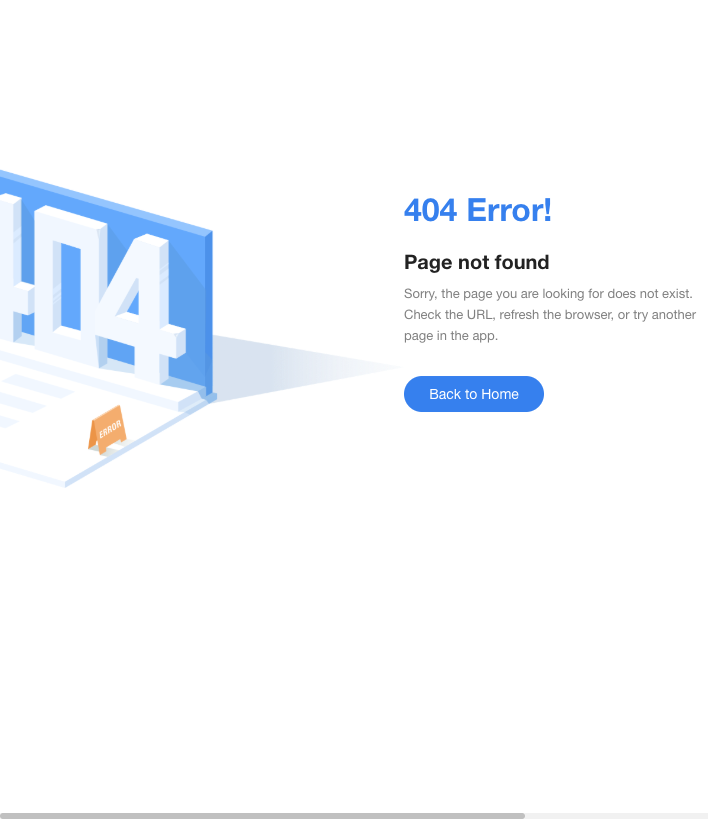

# 管理后台

测试环境新后台 `https://test-new-admin.vtron-card.com`。登录的是 Main Admin（`sys_role.role_key = main`）。银行后台这次没打开。

这一遍要看的是发信日志。菜单定义在旧表 `virtronex_main.sys_menu`：`2290`，中文「邮件发送日志」，英文 “Email Send Log”，挂在 Authority → Log Management 下面。`parent_id = 108`（path `log`），再上一级是 `1`（path `system`）。组件 `finance/emailSendLog/index`，权限 `bu:log:emailSend:list`。`2291` 是查询按钮，权限同一串。`visible = 0`、`status = 0`，这套表里是显示且启用。

Main Admin 的角色菜单里有 `108` 和 API Behavior Log（`2292`），没有 `2290`。`sys_role_menu` 里没有任何角色挂着 `2290`。侧栏 Authority 下能看到的是 Operation Log、Access Records、Google Bindings、API Behavior Log、Apple Bindings、Merchant Login Log，没有 Email Send Log。已登录路由里也没有 `emailSendLog`。

直接打开 `/finance/emailSendLog` 和 `/system/log/emailSendLog`，都是 404：“Page not found”，下面 `Back to Home`。列表、筛选、详情都没出来。

接口在源码里是 `POST /log/emailSend/page`，`LogController.emailSendPage`。权限是 `bu:log:emailSend:list` 或 `main:log:emailSend:list`。页面源码的筛选项是收件邮箱、模板、标题、触发方类型、收件方类型、发送状态（Pending / Success / Failed）、日期。列是 ID、To、Template、Subject、Status、Actor Type、Recipient Type、BU ID、Created。行上只有 Detail。详情多出发件邮箱、失败短码、失败摘要，可以复制失败摘要。这次这些都没有渲染。

维护邮件批次是旁边的 `2280`，同样没有挂到角色上，这一遍不打开。
