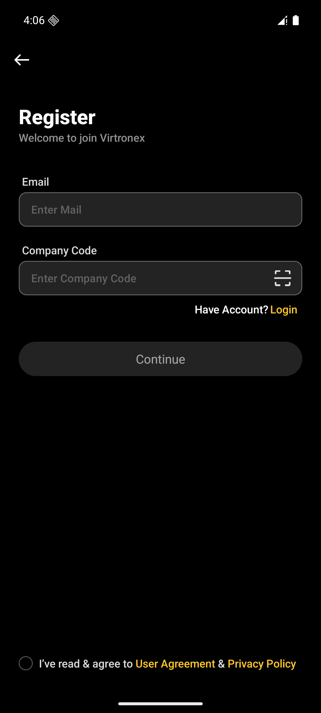
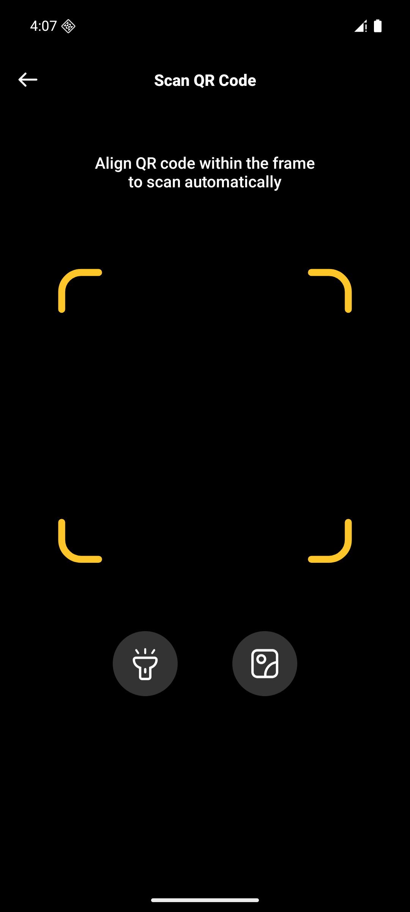
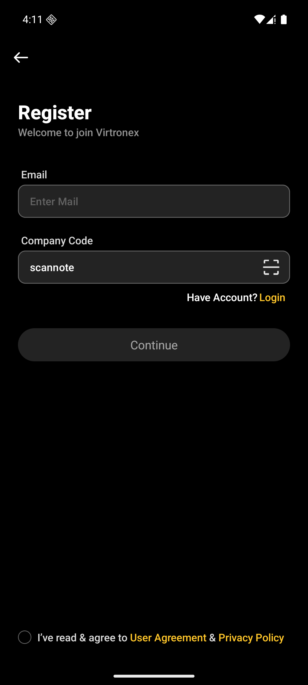

# 用户视角

Android `dev`，包 `com.vtron.pay`，模拟器 `emulator-5554`。H5、Web、iOS 这次没打开。

## 1. 注册页可以手填

登录页点 `Register`。公司码是输入框，提示 “Enter Company Code”，右侧是扫码图标。可以空着。邮箱还空时 `Continue` 是灰的，不是因为没填公司码。

## 2. 扫码页

点扫码图标，允许相机后进入 `ScanQrCodeActivity`。标题 “Scan QR Code”，说明 “Align QR code within the frame to scan automatically”。下面是手电筒和相册。模拟器预览是黑的。返回留在注册页，输入框不动。

相册选了一张没有 `companyCode` 的链接。`POST /api/v1/qr/resolve`，`type` 是 `invite_code`。返回 `40094`，红条 “This QR code is not supported.”。停在扫码页，大约 4 秒后继续扫。注册页的输入框还在，没有被清掉，也没有被锁上。

相册再选一张 `companyCode=scannote` 的链接。回到注册页，输入框里是 `scannote`。这不是库里的邀请码，只用来看填进去。没有点 `Continue`。

相册里的图本身不是二维码时，本地就提示 “Unable to recognize QR code”，不会发解析请求。这次没另截。

## 3. 设密页

邮箱注册的设密页不显示公司码。`activity_set_password.xml` 里这块默认 `gone`，只有 Google 注册才显示，扫码图标也在那一块里。这次没走 Google 注册，设密页没打开。

## 4. 其他端

搜过 `qr/resolve`、`ScanQr`、`companyCode`。

H5 `test` 这次没跑。注册页 `pages/auth/register` 和设密页 `pages/auth/setPassword` 的公司码右侧都有扫码图标。点开是 Upload / Take Photo，再调 `POST /api/v1/qr/resolve`。认不出时文案也是 “Unable to recognize QR code”。输入框仍可手填。

Web `newtest` 有入口，不是无。注册卡片上公司码标了 *required，旁边是选图，`src/lib/qr/qrResolve.ts` 调同一个接口。地址里已经带了 `companyCode` 时输入框只读，不再显示选图。界面见 `02-邮箱注册登录` 的 `assets/02-25-web注册.png`。这次没再打开。

iOS `release` 有入口，不是无。`ZZXRegisterController` 的 `ScanClick` 打开 `ZZXScanQRCodeController`，请求 `POST /api/v1/qr/resolve`，`type` 是 `invite_code`，成功写回公司码输入框。这次没跑。

## 5. 和稿

这次没再打开 Figma。页 `0:1` 上注册帧的对照见 `02-邮箱注册登录` 第 18 步，那里没有单独的扫码页。

## 本步没有

- 用扫到的码真正提交注册
- Google 注册的设密页
- H5、Web、iOS 的界面
